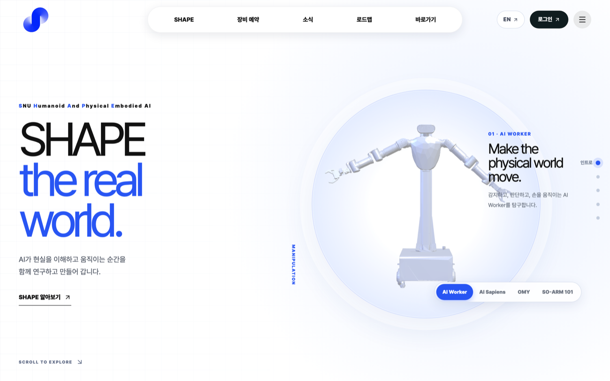
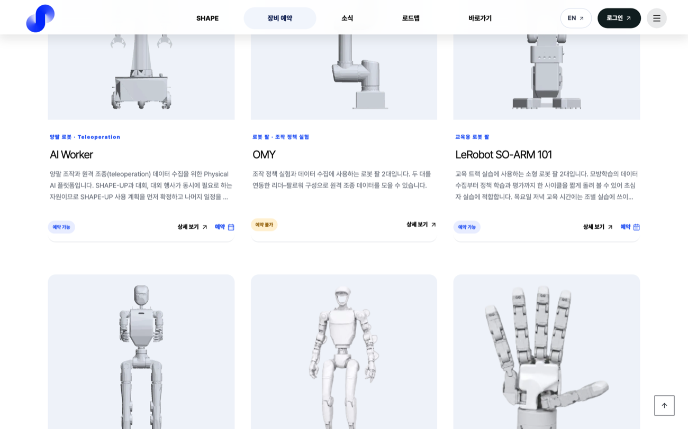
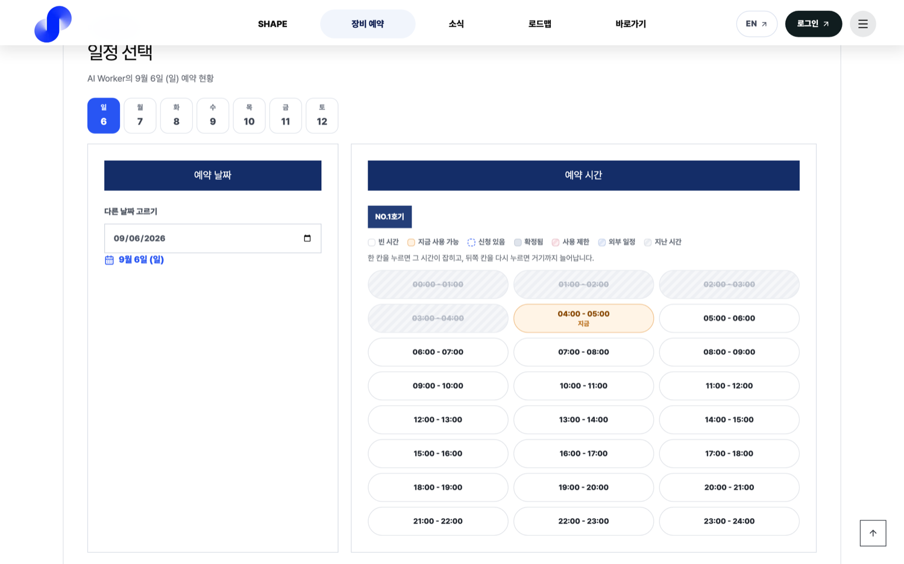

# SHAPE Web

서울대학교 휴머노이드·Physical AI 동아리 SHAPE의 웹사이트와 운영 시스템.
동아리 소개부터 장비 예약·사용 자격·회원 권한 관리까지 프런트엔드와 백엔드를 직접 개발했다.

[웹사이트](https://www.snu-shape.com)

- **성격:** 동아리 운영 시스템 · 공개용 스냅숏
- **주요 작업:** 프런트엔드·백엔드 · 장비 예약 · 회원 권한 · 배포
- **기술:** Next.js · TypeScript · FastAPI · PostgreSQL · three.js



<sub>운영 사이트에서 촬영한 공개 소개 화면. 이 저장소는 공개용으로 정리한 시점의 스냅숏이다.</sub>

## 프로젝트 개요

| 영역 | 내용 |
| --- | --- |
| 동아리 소개 | 부원·소식·공지·장비·활동 로드맵 |
| 장비 예약 | 호기별 시간표, 사용 자격 확인, 신청·승인·자동 확정 |
| 회원 운영 | 가입 승인, 기능별 권한 위임, 게시판, 웹 푸시, 감사 로그 |

<table>
<tr>
<td width="50%"></td>
<td width="50%"></td>
</tr>
<tr>
<td><sub>보유 장비와 사용 조건</sub></td>
<td><sub>호기별 예약과 사용 가능 시간</sub></td>
</tr>
</table>

## 구현 내용

Next.js·FastAPI·PostgreSQL을 연결하고 Vercel·Render·Neon의 무료 티어에 맞춰 배포했다.
데이터베이스가 깨어 있는 시간과 동시 연결 수를 줄이기 위해 캐시 만료 시점과 중복 요청을 조정했다.
예약 정책은 운영진이 변경할 수 있게 데이터베이스로 옮기고, 자격·권한에 따른 응답은 공개 캐시와 분리했다.

[설계 기록](docs/design-notes.md)과 [무료 티어 운영 기록](docs/free-tier-deployment.md)에 판단 과정과 실측이 있다.

## 시작하기

Google OAuth·Neon 없이 SQLite와 예시 데이터로 확인할 수 있다.

```bash
cd backend
uv sync
DATABASE_URL="sqlite+aiosqlite:///$(pwd)/dev.sqlite3" SESSION_SECRET="local-development-secret-value" \
  uv run python scripts/dev_seed.py
DATABASE_URL="sqlite+aiosqlite:///$(pwd)/dev.sqlite3" SESSION_SECRET="local-development-secret-value" \
  FRONTEND_URL="http://localhost:3000" uv run uvicorn app.main:app --port 8000
```

다른 터미널에서 웹을 실행한다.

```bash
cd frontend
npm install
npm run dev
```

시드가 출력한 토큰을 localhost의 `shape_session` 쿠키에 넣으면 예시 운영진 계정으로 확인할 수 있다.
토큰 재발급과 테스트 명령은 [로컬 데모 안내](docs/demo.md), 외부 서비스 설정은 [환경 설정](docs/setup.md)에 있다.

## 문서

| 문서 | 내용 |
| --- | --- |
| [시스템 구조](docs/architecture.md) | 프런트엔드·백엔드·도메인 경계 |
| [환경 설정](docs/setup.md) · [로컬 데모](docs/demo.md) | 실행, 환경변수, 예시 계정, 테스트 |
| [설계 기록](docs/design-notes.md) | 캐시, 예약 규칙, 알림과 반응형 화면 |
| [무료 티어 운영](docs/free-tier-deployment.md) | 비용 제약과 실측 |

## 공개 범위

운영 저장소를 정리한 **공개용 스냅숏**으로, 운영본과 자동 동기화하지 않는다.
실명·부원 사진을 제거하고 시드 계정·이메일·게시글은 예시 값으로 바꿨다.
실제 서비스의 현재 기능과 이 저장소의 기능은 다를 수 있다.

## 관련 프로젝트

[SHAPE 디자인 키트](https://github.com/sesepark/shape-web-design) — 사이트의 색·글자·여백을 발표자료와 포스터에도 활용하기 위해 정리한 자료.
