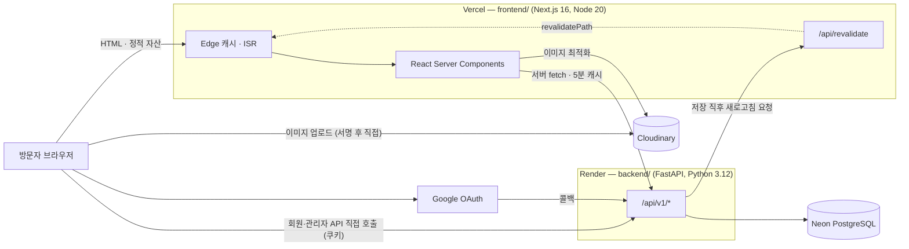
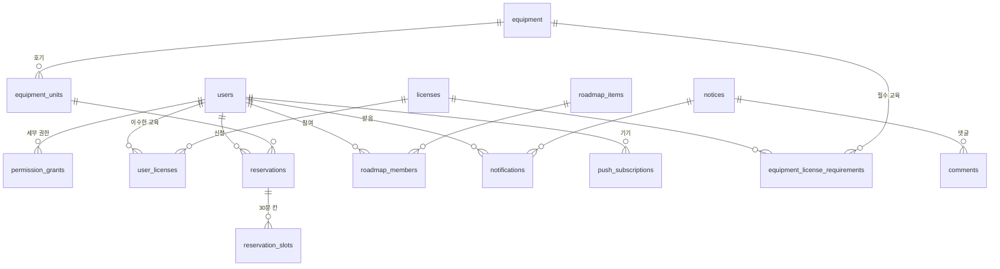

# SHAPE 웹 구조

이 문서 하나만 읽고도 `shape_web` 에서 작업을 시작할 수 있도록 쓴 지도입니다.
Claude·Codex 같은 도구가 저장소를 처음 열었을 때 가장 먼저 읽을 문서를 의도했습니다.

관련 문서와 역할이 겹치지 않게 나눠 두었습니다.

| 문서 | 다루는 것 |
|---|---|
| **이 문서** | 무엇이 어디에 있고, 요청이 어떤 경로로 흐르는가 |
| [`setup.md`](setup.md) | 외부 서비스 연결 절차, 배포 설정, 첫 운영 준비 순서 |
| [`free-tier-deployment.md`](free-tier-deployment.md) | 무료 한도를 지키는 캐시·비용 규칙과 실측 용량표 |
| [`../README.md`](../README.md) | 로컬에서 띄우는 방법 |

---

## 0. 먼저 — 모든 수정은 모바일을 함께 본다

**이 저장소에서 화면을 건드리는 모든 변경은 좁은 화면에서 어떻게 되는지 함께
확인해야 합니다.** 데스크톱에서 잘 보이는 것만 보고 끝내지 마세요. 운영자가
반복해서 지적한 사항이고, 실제로 가장 자주 나온 누락입니다.

바꾸기 전에 확인할 것:

| 확인 | 왜 |
|---|---|
| 360~430px 폭에서 넘치거나 잘리는 곳이 없는가 | 국내 사용 기기의 대부분이 이 폭입니다 |
| 홈처럼 한 화면이 한 장인 구조에서 한 장이 화면 높이를 넘지 않는가 | 넘치면 다음 장이 반쯤 보이는 어정쩡한 상태가 됩니다 |
| 표·격자·가로로 긴 요소가 단을 줄이거나 가로 스크롤 상자로 바뀌는가 | 본문이 가로로 밀리면 페이지 전체가 흔들립니다 |
| 손가락으로 누를 대상이 충분히 큰가 | 마우스 기준으로 만든 작은 버튼은 휴대폰에서 못 누릅니다 |

**높이를 다룰 때 `svh` 와 `dvh` 를 구분해 쓰세요.** `svh` 는 주소 표시줄이 나와
있는 가장 좁은 상태의 높이라 **안쪽 글자와 여백**을 묶는 데 씁니다. `dvh` 는
지금 보이는 높이를 따라가므로 **섹션 자체의 높이**에 씁니다. 고정 픽셀로 여백을
쌓으면 사파리에서 표시줄이 접혔다 펴질 때 첫 화면이 잘립니다.

새 CSS 를 넣을 때 데스크톱 규칙만 쓰고 반응형 분기를 빠뜨리는 것이 가장 흔한
실수입니다. 보고하기 전에 스스로 한 번 더 확인하세요.

### 눈대중으로 하지 말고 실제 브라우저로 재세요

여백을 어림해서 줄이면 거의 맞지 않습니다. 실제로 재어 보니 홈의 네 장이 모두
52~273px 넘치고 있었고, 머리글이 첫 내용을 최대 74px 가리고 있었습니다.
둘 다 눈대중으로는 보이지 않던 것입니다.

Playwright 를 저장소 밖(스크래치 폴더)에 설치해 씁니다. **`package.json` 에는
넣지 마세요.** devDependency 는 Vercel 빌드에서도 설치되어 배포가 무거워집니다.

```bash
mkdir -p /tmp/e2e && cd /tmp/e2e && npm init -y && npm i -D playwright
npx playwright install chromium
```

재는 요령 두 가지가 있습니다.

* **스냅 자리 기준으로 재세요.** 머리글이 92px 이고 `scroll-padding-top` 이
  걸려 있으므로, 첫 장을 뺀 나머지 장이 들어갈 자리는 `화면 높이 − 92px` 입니다.
* **`scrollIntoView()` 로 옮기세요.** `window.scrollTo(offsetTop)` 은
  `scroll-padding-top` 을 무시해서, 멀쩡한 화면도 머리글에 가린 것처럼 보입니다.

WebGL 캔버스는 `preserveDrawingBuffer` 없이 `drawImage` 로 읽으면 빈 화면이
나옵니다. 로봇이 그려졌는지 볼 때는 **화면 캡처**(`locator.screenshot()`)를
쓰세요. 캡처는 합성된 프레임을 담습니다.

---

## 1. 전체 구성



세 서비스 모두 무료 티어입니다. 이용자는 20~70명 규모이며, **비용을 좌우하는 것은
전송량이 아니라 요청 수**입니다. 자세한 수치는 `free-tier-deployment.md` 를 보세요.

### 도메인

| 주소 | 가리키는 곳 |
|---|---|
| `www.snu-shape.com` | Vercel (프런트엔드) |
| `snu-shape.com` | `www` 로 308 리다이렉트 |
| `api.snu-shape.com` | Render (백엔드) |

프런트엔드와 백엔드가 **서로 다른 출신지**라는 점이 구조 전반을 결정합니다.
쿠키는 `COOKIE_DOMAIN` 으로 상위 도메인에 걸고, CORS 는 `FRONTEND_URL` 하나만
허용하며, 모든 회원용 요청은 `credentials: "include"` 로 나갑니다.

---

## 2. 요청이 흐르는 세 가지 길

작업하기 전에 지금 만지는 화면이 셋 중 어디에 속하는지 먼저 판단하세요.
캐시 정책과 인증 방식이 전혀 다릅니다.

### (가) 공개 페이지 — 서버에서 그리고 CDN 이 들고 있음

`/`, `/about`, `/news`, `/members`, `/equipment`, `/roadmap`, `/links`, `/shape-up` 등.

1. Next.js 서버 컴포넌트가 `src/lib/api.ts` 의 `api.*()` 로 백엔드를 호출합니다.
   이 fetch 는 `next: { revalidate: 3600 }` 이라 **한 시간 동안 Next.js Data Cache**
   에 남습니다.
2. 그 호출이 백엔드까지 갔더라도 `app/cache.py` 의 공개 응답 캐시가 한 번 더
   막아 줍니다. 같은 길이의 창을 쓰되, 만료가 한 순간에 몰리지 않게 창구마다
   30초 안에서 흩어 두고, 같은 창구는 하나만 채우고 나머지는 기다립니다.
3. 그린 HTML 은 Vercel Edge 캐시에 올라가고, 방문자는 대부분 CDN 에서 받습니다.
   빌드 출력의 `○`(정적) 또는 `●`(경로별 정적)가 이 상태입니다.
4. 관리자가 무언가 저장하면 백엔드가 자기 캐시를 버리고 `POST /api/revalidate` 로
   알려 주어, 해당 경로가 즉시 새로 그려집니다.
   (`app/services/revalidate.py` ↔ `src/app/api/revalidate/route.ts`)

> **한 시간이라는 값은 느슨해서가 아니라, 저장이 그 자리에서 새로 고치기 때문에
> 고를 수 있는 값입니다.** 이 재검증 경로를 끊으면 그 순간 한 시간짜리 지연이
> 진짜 지연이 됩니다. 그래서 `refresh()` 는 실패하면 한 번 더 두드립니다.
>
> **회원이 보는 화면은 이 이야기와 무관합니다.** 게시판·예약·마이페이지·관리자는
> 세션 쿠키가 실려 오므로 캐시를 통째로 비켜 가고, 늘 그 순간의 값입니다.
>
> **왜 한 시간인가.** Neon 무료 compute 는 월 100 CU-시간이고 5분만 놀면 잠듭니다.
> 재검증 주기가 5분이던 동안에는 방문이 이어지는 내내 데이터베이스가 깨어 있어서,
> 베타 이용자 다섯 명만으로 한도의 64% 를 쓰고 있었습니다. 자세한 계산은
> [`free-tier-deployment.md`](free-tier-deployment.md) 에 있습니다. 이 값을 다시
> 줄이려면 그 문서의 실측표를 먼저 보세요.

상세 페이지(`/news/[id]`, `/equipment/[id]`, `/shape-up/[id]`)는 `generateStaticParams`
로 빌드 때 미리 그려 둡니다. 목록을 못 받아 오면 빈 배열을 돌려주므로, 배포 중
백엔드가 자고 있어도 빌드가 깨지지 않고 그 주소는 예전처럼 그때그때 그려집니다.

### (나) 회원 화면 — 브라우저가 백엔드를 직접 호출

`/mypage`, `/notices`, `/equipment/reserve`, `/equipment/status`, `/resources`.

서버에서 그리지 않습니다. 클라이언트 컴포넌트가 `fetch(API_URL + …, { credentials: "include" })`
로 백엔드를 직접 부르고, 백엔드는 `shape_session` 쿠키로 신원을 확인합니다.
이 응답은 전부 `private, no-store` 입니다.

### (다) 관리자 화면 — `/admin` 한 페이지

`src/components/admin-console.tsx` 하나가 모든 관리 기능을 담고 있습니다(약 2,000줄).
탭마다 `/api/v1/admin/*` 을 호출하며, 각 요청은 백엔드에서 권한을 다시 확인합니다.
**프런트엔드의 탭 노출은 편의일 뿐 보안 경계가 아닙니다.**

---

## 3. 백엔드 — `backend/`

```
backend/
├── app/
│   ├── main.py          FastAPI 앱과 미들웨어 4겹
│   ├── config.py        환경변수 → Settings (lru_cache 로 한 번만 읽음)
│   ├── database.py      비동기 엔진과 세션. Neon URL 정규화가 여기 있음
│   ├── models.py        SQLAlchemy 테이블 정의
│   ├── schemas.py       Pydantic 입출력 모델 (camelCase 로 나감)
│   ├── security.py      세션 쿠키, 권한 확인 의존성
│   ├── middleware.py    요청 크기·유량 제한과 캐시 헤더
│   ├── routers/         auth · public · member · media · admin
│   └── services/        content · link_preview · notifications · reservations · revalidate
├── alembic/versions/    스키마 이력
├── scripts/             시드와 이관 스크립트 (5절)
└── tests/test_api.py    전 기능 통합 테스트 46개
```

### 미들웨어는 바깥부터 이 순서로 겹칩니다

`main.py` 의 `add_middleware` 는 **나중에 붙인 것이 바깥**입니다. 실제 순서는

```
CORS → Session → CostGuard → GZip → 라우터
```

* **CORS** — `FRONTEND_URL` 한 곳만 허용. `allow_credentials=True` 라 와일드카드를 쓸 수 없습니다.
* **Session** — Google OAuth 의 state 를 담는 서명 쿠키.
* **CostGuard** (`middleware.py`) — 이 프로젝트에서 가장 중요한 미들웨어입니다.
  * 본문이 `MAX_REQUEST_BYTES`(2MB)를 넘으면 **DB 세션을 열기 전에** 413 으로 거절합니다.
  * 분당 공개 읽기 120회 / 쓰기 20회로 제한합니다. **로그인한 회원은 계정별로,
    나머지는 주소별로** 셉니다. 학교 Wi-Fi 처럼 여러 명이 한 IP 를 쓰는 곳에서
    서로의 한도를 깎지 않게 하기 위해서입니다.
  * 응답에 `Cache-Control` 을 붙입니다. **허용 목록 방식**이고(`PUBLIC_READS`),
    **세션 쿠키가 실린 요청은 공개 읽기라도 `private, no-store`** 로 내려갑니다.
    `/shape-up` 처럼 같은 주소인데 보는 사람에 따라 `canEdit` 이 달라지는 응답이
    있기 때문입니다.
* **GZip** — 500바이트 넘는 응답을 압축. 한글 JSON 은 `\uXXXX` 로 나가 55~68% 줄어듭니다.
  앞단에 프록시가 없어 앱이 직접 합니다.

> 공개 읽기 경로를 새로 만들면 `PUBLIC_READS` 에 넣어야 캐시가 붙습니다.
> 반대로, 보는 사람에 따라 내용이 달라지는 응답을 그 목록에 넣으면 안 됩니다.

### 권한 모델

두 층으로 되어 있습니다.

| 층 | 값 | 확인 지점 |
|---|---|---|
| 계정 상태 | `PENDING` / `APPROVED` / `VIEWER` / `REJECTED` / `SUSPENDED` | `approved_user`(쓰기) · `reading_user`(읽기) |
| 소유자 | `users.is_owner` | `owner_only` |
| 세부 권한 | `permission_grants.permission` 문자열 | `require_permission("…")` |

**등급은 세 갈래입니다.** 운영진은 owner(모든 확인을 통과), 준회원·정회원은
`APPROVED`, 멤버는 `VIEWER` 입니다.

> **`VIEWER` 는 읽기만 합니다.** 회원 전용 화면에 들어와 공지·자료실·예약 현황을
> 읽되 글쓰기·댓글·예약 신청은 하지 않습니다. **읽는 창구에는 `reading_user`,
> 무언가를 남기는 창구에는 `approved_user`** 를 씁니다. 새 창구를 만들 때 이
> 둘을 헷갈리면 보기 전용 회원이 글을 쓰거나(느슨) 아예 못 들어옵니다(빡빡).
> 화면 쪽에서도 단추를 감춰야 합니다 — 눌러 봐야 서버가 막으므로 없는 편이 낫고,
> 그 자리에 `.read-only-note` 로 왜 없는지 적습니다.

> **owner 는 여러 명일 수 있습니다.** 예전에는 `INITIAL_OWNER_EMAILS` 에 적힌
> 계정만 owner 가 되어, 회장이 바뀌면 환경변수를 고치고 다시 배포해야 했습니다.
> 이제 기존 owner 가 `PATCH /admin/users/{id}/owner` 로 지명합니다. 지명하면
> 관리 권한도 함께 채워집니다. 자기 자신은 내릴 수 없고, 마지막 owner 도
> 내릴 수 없습니다.

쓰이는 권한 문자열은 `content:manage`, `news:manage`, `notices:manage`,
`equipment:manage`, `roadmap:manage`, `links:manage`, `reservations:manage` 입니다.
**owner 는 모든 확인을 무조건 통과**합니다(`has_permission` 첫 줄).

### 데이터 모델



읽기 전용에 가까운 표는 위 그림 밖에 있습니다: `content_pages`(슬러그별 편집 페이지),
`news_posts`, `related_links`, `shape_up_posts`, `resources`.

기억해 둘 만한 설계 두 가지:

* **JSON 컬럼은 제자리에서 고치면 저장되지 않습니다.** `page.content_json["members"]`
  안의 사전을 직접 바꾸고 커밋하면 SQLAlchemy 가 바뀐 줄 모르고 UPDATE 를 내보내지
  않습니다(이 저장소에서 실제로 겪었습니다). 새 값을 만들어 통째로 넣으세요.
* **`UtcDateTime`** (`models.py`) — 모든 시각 컬럼은 저장과 조회 양쪽에서 UTC 로
  맞춥니다. 로컬 개발용 SQLite 가 시간대를 떼어 버려 화면에서 9시간씩 어긋나던
  문제를 막습니다. 새 시각 컬럼도 반드시 이 타입을 쓰세요.
* **`reservation_slots`** — 승인된 예약을 30분 칸으로 펼쳐 `(호기, 시작시각)` 에
  고유 제약을 겁니다. **겹침 방지는 애플리케이션 로직이 아니라 데이터베이스 제약**
  이 책임집니다. 신청 단계에서 미리 걸러 주기는 하지만 최종 방어선은 이 제약입니다.
  겹침을 막는 기준이 **사람이 아니라 호기**라는 점도 여기서 나옵니다. 한 사람이
  로봇 팔과 GPU 워크스테이션을 같은 시간에 함께 잡는 것은 정상이고, 실제로 흔합니다.

### 라우터가 나뉜 기준

| 라우터 | 인증 | 내용 |
|---|---|---|
| `auth.py` | — | Google OAuth 시작·콜백, 세션 조회, 로그아웃, 내 프로필 |
| `public.py` | 없음 | 공개 페이지가 읽는 것 전부 |
| `member.py` | 승인 회원 | 게시판, 예약, 알림, 자료실, SHAPE-UP, 내 로드맵 |
| `media.py` | 승인 회원 | Cloudinary 업로드 서명 발급 |
| `admin.py` | 권한별 | 관리 기능 전부 |

`/resources` 와 `/shape-up` 은 `optional_user` 를 써서 **로그인 여부에 따라 응답이
달라집니다**. 이 둘을 건드릴 때는 위의 캐시 규칙을 꼭 함께 확인하세요.

### 부원 카드와 구글 계정은 하나로 이어집니다

부원 한 명에 두 곳이 관여합니다. **부원 카드**(`content_pages/members` 의
`content_json.members[]`)는 운영진이 이름·팀·역할·소속을 적는 자리이고,
**구글 계정**(`users`)은 본인이 사진과 소개말을 관리하는 자리입니다. 카드의
`userId` 가 둘을 잇습니다.

> **연결된 카드는 사진과 소개말을 계정에서 가져옵니다.** 예전에는 상세 대화창만
> 그랬고 카드 격자는 카드에 저장된 사진을 써서, 계정을 연결해 두고도 두 사진이
> 갈렸습니다. 지금은 `member-directory.tsx` 의 `photoOf()` 한 곳이 정합니다.
> 이름·팀·역할·소속은 계속 운영진이 관리합니다. 구글 계정 이름은 영문이거나
> 이메일 앞부분인 경우가 있어 그대로 쓰면 부원 페이지가 흐트러집니다.

**아직 로그인하지 않은 부원** 은 카드에 저장된 사진을 그대로 씁니다.

> **연결은 본인이 합니다. 운영진이 하나씩 맞추지 않습니다.** 로그인하면
> 마이페이지 › ‘내 부원 카드’ 에 **이름이 같은** 미연결 카드가 후보로 뜨고,
> 본인이 고르면 붙습니다. 마흔 장을 운영진이 손으로 맞추는 것보다 정확하고,
> 새 부원이 들어와도 저절로 이어집니다.

| 하는 일 | 어디서 | API |
| --- | --- | --- |
| 내 카드·후보 보기 | 마이페이지 | `GET /auth/me/member-card` |
| 내 카드로 연결 | 마이페이지 | `POST /auth/me/member-card` |
| 연결 놓기 | 마이페이지 · 관리자 | `DELETE /auth/me/member-card` |

집을 수 있는 카드는 **이름이 같고 아직 아무도 집지 않은** 것뿐입니다. 이름이
다르면 403, 남이 이미 집었으면 409 입니다. 한 계정은 카드 하나만 가지므로 다른
카드를 집으면 앞의 것은 저절로 놓입니다. 집을 때 **카드 사진이 있고 내 계정
사진이 아직 구글에서 가져온 것 그대로이면(`googleusercontent.com`) 카드 사진을
계정 사진으로 삼습니다.** 두 프로필이 갈려 보이던 것을 하나로 모으는 자리가
여기입니다.

관리자 › 부원 탭에는 **고르는 자리가 없습니다.** 연결 현황과 미연결 명단을
보여 주고, 잘못 연결된 카드만 풀어 줍니다.

> **관리자 화면이 공개 응답을 읽을 때는 `cache: "no-store"` 를 붙이세요.**
> `/pages/*` 는 방문자용으로 60초 캐시됩니다. 그냥 읽으면 방금 저장한 값 대신
> 최대 1분 전 응답이 돌아옵니다. 실제로 카드에 계정을 연결하고 저장해도 곧바로
> 다시 풀린 것처럼 보였습니다(서버에는 저장되어 있었습니다).
> `admin-console.tsx` 의 `PUBLIC_READ` 가 그 설정입니다.

### 한 장이 화면에 들어오는지 잴 때는 **그 장을 화면에 띄운 뒤에** 재세요

홈의 각 장에는 아직 화면에 오지 않았을 때 `translateY(30px)` 로 내려 둔 조각이
있습니다(`.home-reveal`). CSS 에서 스크롤 넘침 영역은 변형(transform)까지 포함해
계산하므로, 화면 맨 위에서 `scrollHeight` 를 재면 **아직 오지 않은 장이 16px 쯤
넘치는 것처럼** 나옵니다. 실제로 이 값을 보고 여백을 깎다가 아무 문제 없던 자리를
건드릴 뻔했습니다.

    // 틀림 — 맨 위에서 전부 잰다
    sections.map((s) => s.scrollHeight - s.clientHeight)

    // 맞음 — 장을 화면에 올린 뒤 그 장만 잰다
    s.scrollIntoView({ behavior: "instant", block: "start" });
    await wait(1500);            // 장이 `in-view` 를 받고 변형이 풀릴 때까지
    s.scrollHeight - s.clientHeight

### 데이터베이스 구조는 서버가 뜰 때 스스로 맞춥니다

Render 는 새 코드를 밀어 넣으면 알아서 배포하는데, 마이그레이션은 사람이 따로
실행해야 했습니다. 그 사이에 **새 컬럼을 읽는 코드가 먼저 올라가면 그 기능이
통째로 500** 이 됩니다. 알림에 갈 곳(`url`) 칸을 더할 때 실제로 그럴 뻔했습니다.

지금은 `app/main.py` 의 lifespan 이 뜰 때 한 번 `alembic upgrade head` 를
실행합니다. 무료 티어라 서버가 하나뿐이므로 경쟁이 없습니다. 실패해도 서버는
계속 뜨고 로그에 남깁니다 — 마이그레이션 하나 때문에 사이트 전체가 닫히는 쪽이
더 나쁘기 때문입니다. 로컬과 자동 시험은 SQLite 라 건너뜁니다.

그래도 **마이그레이션은 되돌릴 수 있게 쓰세요.** 자동으로 도는 만큼, 잘못 쓴
마이그레이션은 배포하는 순간 운영 데이터에 닿습니다.

### `public/` 안의 사진을 바꾸면 **주소도 바꾸세요**

이미지 최적화 결과를 1년 동안 들고 있습니다(`next.config.ts` 의
`minimumCacheTTL`). 무료 요금제에서 세는 것이 변환 횟수라 일부러 길게 잡은
값입니다. 그런데 캐시의 열쇠는 **주소** 라서, 파일 내용만 바꾸고 주소를 그대로
두면 바뀐 것을 알 길이 없습니다. 장비 사진을 1200×1200 으로 다시 뽑고도 화면에는
옛 사진이 계속 나왔습니다.

파일을 갈아 끼울 때는 **파일 이름** 을 바꾸세요 — `/equipment/omy-3.png`.
주소 뒤에 `?v=3` 을 붙이는 흔한 방법은 여기서 쓸 수 없습니다. **Next.js 이미지
최적화가 로컬 주소에 붙은 물음표를 받지 않습니다**(실측: 400). 장비 사진 주소는
데이터베이스에 들어 있으므로 마이그레이션으로 함께 바꿉니다
(`20260824_equipment_image_rename.py` 가 그 예입니다). 부원 사진(`/figs/…`)은 파일
이름이 곧 사람 이름이라 내용이 바뀌지 않으므로 이 문제가 없습니다.

### 사진은 자리 크기에 맞춰 받아 옵니다

`media(url, width, quality)` 의 세 번째 값이 화질입니다. 크게 놓이는 사진은
`"high"`, 이름 옆 작은 얼굴은 `"eco"` 입니다. 폭은 **화면에 그려지는 CSS 폭 ×
2**(고해상도 화면) 을 기준으로 잡습니다. 우리 폴더에 있는 사진에는 `sizes` 를
꼭 붙이세요 — 없으면 브라우저가 무조건 1920px 짜리를 받아 갑니다.

    // 자리 391px · 2배 화면이면 782px 필요
    <Image src={media(url, 900, "high")} sizes="(max-width: 900px) 90vw, 420px" quality={90} />

재는 방법은 간단합니다. 브라우저에서 `naturalWidth` 와
`getBoundingClientRect().width × devicePixelRatio` 를 견주면 됩니다. 받은 쪽이
작으면 늘려 그리는 것이고, 그게 사진이 뭉개져 보이는 가장 흔한 이유입니다.

### 목록 응답에는 본문을 싣지 마세요

게시판 목록은 게시된 글을 **전부**, 본문까지 담아 보내고 있었습니다. 목록 화면은
제목·분류·글쓴이·날짜·댓글 수만 그리므로 본문은 통째로 버려졌습니다. 게시판은
회원 전용이라 공유 캐시도 태울 수 없어, 글이 쌓이는 만큼 목록을 여는 사람마다
무거운 응답이 나갑니다.

지금은 `NoticeRead`(목록)에 본문이 없고 `NoticeDetailRead`(상세)에만 있습니다.
한 번에 30개까지 보내고, 더 오래된 글은 `?before=<마지막 글의 publishedAt>` 으로
이어 받습니다. 화면의 '이전 글 더 보기' 가 그 자리입니다. 새 목록 API 를 만들 때
같은 두 가지를 확인하세요 — **목록에 본문이 없는가, 개수 상한이 있는가.**

### 올린 사진은 세 단계로 줄어듭니다

무료 티어에서 가장 먼저 닳는 것이 전송량이고, 그 대부분을 글에 박힌 사진이
씁니다. 세 자리에서 줄입니다.

1. **올릴 때** — `src/lib/upload.ts` 의 `shrink()` 가 브라우저에서 가로 1600px,
   WebP 로 바꿔 보냅니다. 실측 638KB → 44KB. 이미 작은 사진과 GIF 는 그대로 둡니다.
2. **저장할 때** — `sanitize_html` 이 본문의 Cloudinary 주소에
   `f_auto,q_auto,c_limit,w_1400` 을 붙이고 `loading="lazy"` 를 답니다.
3. **내보낼 때** — `DeliveredHtml`(schemas.py)이 같은 규칙을 한 번 더 적용합니다.
   규칙이 생기기 전에 저장된 글까지 덮기 위한 자리입니다.

표지 사진은 화면 쪽 `media()` 가 같은 일을 합니다. **편집기가 넣은 주소를 그대로
믿지 마세요.** 원본은 휴대폰 사진 그대로입니다.

### 소식과 언론보도는 같은 표를 나눠 씁니다

둘 다 `news_posts` 이고 `category` 로만 갈립니다. 언론보도는 `"언론보도"`,
나머지가 소식입니다. 그래서 목록을 부를 때 **소식 탭은 `?exclude=언론보도`,
언론보도 탭은 `?category=언론보도`** 로 서로를 뺍니다. 분류 이름은
`src/lib/api.ts` 의 `PRESS_CATEGORY` 한 곳에 있습니다.

거르기를 화면에서 하지 마세요. `limit` 만큼 받아 온 뒤 버리면 한쪽이 늘어나는
만큼 다른 쪽이 목록 밖으로 밀려납니다. 다만 **사이트맵과 상세 페이지 미리
그리기는 전체를 부릅니다.** 언론보도 상세도 검색에 잡히고 CDN 에서 나가야
하기 때문입니다.

---

## 4. 프런트엔드 — `frontend/`

```
frontend/
├── src/app/          App Router. 폴더 = URL
├── src/components/   화면 조각
├── src/lib/          api · media · members · navigation · format · types …
└── public/
    ├── figs/         옛 사이트에서 옮겨 온 부원 사진
    ├── models/       홈 화면 로봇 3D (.glb, 합계 약 1.4MB)
    └── sw.js         푸시 알림과 아이콘 캐시용 서비스 워커
```

### 스타일

전역 CSS 다섯 장을 `layout.tsx` 에서 한꺼번에 불러옵니다
(`globals` → `responsive-additions` → `feature-additions` → `header-fixes` → `site-polish`).
**뒤에 오는 파일이 앞을 덮는 구조**이므로, 스타일이 안 먹으면 뒤쪽 파일에 같은
선택자가 있는지 먼저 보세요. 압축 후 합계 약 33KB 이고 모든 페이지에 실립니다.

### 이미지 — 비용이 가장 크게 갈리는 곳

`src/lib/media.ts` 의 두 함수가 전부입니다.

* `media(url, width)` — Cloudinary 주소면 `f_auto,q_auto,c_limit,w_*` 를 끼워 넣고,
  옛 사이트 절대 주소(`https://www.snu-shape.com/figs/…`)면 **상대 경로로 바꿉니다.**
  절대 주소로 두면 이미지 최적화가 제 사이트에 HTTP 요청을 한 번 더 보냅니다.
* `optimizable(url)` — Next.js 최적화에 넘겨도 되는 주소인지 판정합니다.
  `remotePatterns` 에 없는 주소를 넘기면 400 이 납니다.

`next.config.ts` 의 `minimumCacheTTL` 은 1년입니다. Vercel 무료 요금제가 세는 것은
전송량이 아니라 **변환 횟수(월 5,000회)** 이기 때문입니다.

#### 사진이 놓이는 자리는 변수로 고정합니다

관리자가 어떤 크기의 사진을 올려도 같은 모양으로 놓이도록, `site-polish.css` 맨
아래에 자리마다 비율과 모서리를 정해 두었습니다. **새 사진 자리를 만들 때 픽셀을
직접 적지 말고 이 변수를 쓰세요.**

| 변수 | 값 | 쓰는 곳 |
|---|---|---|
| `--media-radius` | 16px | 카드와 커버 |
| `--media-radius-inline` | 12px | 글 본문 안의 사진, 작은 미디어 |
| `--media-ratio-card` | 16 / 10 | 목록 카드 썸네일, 원문 미리보기, 장비 |
| `--media-ratio-cover` | 16 / 9 | 글 맨 위의 대표 사진 |
| `--media-ratio-portrait` | 4 / 5 | 인물 사진 |
| `--media-placeholder` | `#eef2f9` | 사진이 없거나 아직 오지 않았을 때의 바탕 |

**커버와 썸네일은 비율을 고정하고 잘라 냅니다**(`object-fit: cover`).
**본문 사진만은 잘라 내지 않습니다** — 도표나 사진 설명이 잘리기 때문에 원본
비율을 지키고 높이만 `70vh` 로 묶습니다. **장비 사진도 잘라 내지 않습니다**
(`contain`). 제품 사진이라 가장자리가 잘리면 무엇인지 알아보기 어렵습니다.

> **`public/figs` 에 사진을 넣을 때 지켜야 할 두 가지**
> 1. 긴 변 1,200px 이내, 사진은 JPEG. PNG 사진 한 장이 3MB 를 먹습니다.
> 2. **파일 이름을 NFC 로 정규화**하세요. macOS 의 `sips` 같은 도구는 한글 파일명을
>    NFD 로 바꿔 놓는데, 리눅스(Vercel)에서는 다른 파일로 취급되어 404 가 납니다.
>    확인: `python3 -c "import unicodedata,os;print([f for f in os.listdir('public/figs') if not unicodedata.is_normalized('NFC',f)])"`

### 글쓰기 도구(TipTap)와 저장 경로

편집기는 `src/components/rich-text-editor.tsx` 하나이고, 게시판·뉴스·SHAPE-UP·
관리자 페이지가 모두 이것을 씁니다. 저장할 때 백엔드가
`app/services/content.py` 의 `sanitize_html` 로 한 번 거릅니다.

> **도구를 새로 붙이면 `ALLOWED_TAGS` / `ALLOWED_ATTRIBUTES` / `ALLOWED_CSS` 를
> 함께 넓혀야 합니다.** 넓히지 않으면 화면에서는 잘 되는데 저장하는 순간
> 조용히 사라집니다. `tests/test_api.py` 의 `test_editor_output_survives_sanitising`
> 에 한 줄 더하면 다음 사람이 같은 함정에 빠지지 않습니다.

또 하나 걸리기 쉬운 것이 **목록 표식**입니다. Tailwind 의 preflight 가
`ol, ul, menu { list-style: none }` 으로 모든 목록의 글머리표와 번호를 지웁니다.
사이트의 목록 대부분은 표식이 없는 편이 맞아서 그대로 두고, `site-polish.css`
맨 아래에서 `.rich-content` 와 `.editor-content .tiptap` 안에서만 되살립니다.
**글 본문에 새 목록 종류를 넣으면 여기도 함께 손대야** 화면에 보입니다.

### 홈은 한 화면이 한 장인 스냅 덱입니다

`html:has(.shape-home)` 에 `scroll-snap-type` 을 걸고 `.shape-home > section` 마다
`min-height: 100dvh` 를 줍니다. 데스크톱은 `y mandatory`, 모바일은 `y proximity`
입니다. 장을 더할 때는 두 가지를 함께 하세요.

1. `src/components/home-scroll-snap.tsx` 의 `SECTIONS` 에 `id` 와 이름을 넣습니다.
   오른쪽 진행 표시와 등장 효과가 여기서 나옵니다.
2. **데스크톱에서 한 장이 화면보다 높아지지 않게** 여백과 간격을 `vh` 로 묶습니다.
   `y mandatory` 에서는 화면보다 높은 장을 읽고 넘어가기가 어렵습니다.

등장 효과는 두 겹입니다. `IntersectionObserver` 가 `.in-view` 를 붙이는 기존
방식이 바탕이고, 그 위에 `animation-timeline` 으로 **스크롤 진행률 자체가 재생
위치가 되는** 효과를 `@supports` 로 얹습니다. 자바스크립트도 스크롤 이벤트도
쓰지 않아 추가 비용이 없고, 지원하지 않는 브라우저는 바탕 효과만 씁니다.
`prefers-reduced-motion` 이 켜져 있으면 둘 다 끕니다.

> **스냅 덱에서 조각마다 `view()` 를 걸면 안 됩니다.** 조각 하나하나가 화면을
> 지나가는 진행률로 재생되는데, 스냅은 장이 화면을 채운 자리에서 스크롤을
> 멈춥니다. 화면 아래쪽 조각은 자기 진행률이 낮은 상태로 멈춰 흐리거나 아예
> 보이지 않는 채로 남습니다(실측: 소개 장의 링크가 opacity 0). 장에
> `view-timeline-name: --home-slide` 를 주고 조각은 `animation-timeline:
> --home-slide` 로 그것을 따르게 하세요. 범위 끝을 `entry 100%` 로 맞추면
> 스냅이 멈추는 자리가 곧 애니메이션이 끝난 자리입니다.

> **머리글은 배경이 투명합니다.** 장의 높이를 화면보다 줄이면 그 띠에 이전
> 장이 그대로 비칩니다. 장은 언제나 `100dvh` 로 두고, 머리글을 비켜 두는 일은
> **장 안쪽 위 여백**(`calc(var(--home-header) + …)`)이 맡습니다. 데스크톱은
> 화면이 높아 여유가 있지만 좁은 화면은 그만큼을 내용에서 덜어내야 하므로,
> 두 값을 나눠 두고 실측으로 맞춥니다.

### 로봇 3D 모델

홈 히어로의 로봇 넷은 각 제조사의 URDF 를 `scripts/build-robot-models.mjs` 로
glb 로 구운 것입니다. URDF 소스는 저장소 밖에 두고 환경 변수로 위치를 넘깁니다.

> **URDF 의 `rpy` 는 고정축 순서입니다.** 부모 좌표계에서 X(roll) → Y(pitch) →
> Z(yaw) 순으로 돌리므로 행렬로는 `Rz·Ry·Rx` 입니다. three 의 `Euler` 는 order 가
> 곱하는 순서를 뜻하므로 **반드시 `"ZYX"`** 를 써야 합니다. `"XYZ"` 를 쓰면
> `rpy` 성분이 둘 이상인 관절만 골라 엉뚱한 자리에 붙어, 팔이 끊어져 보입니다.
> 실제로 SO-ARM 101 의 집게가 공중에 떠 보이던 원인이 이것이었습니다.

만든 뒤에는 **반드시 눈으로 확인**하세요. 브라우저를 띄우지 않고 확인하는 도구가
있습니다.

```bash
cd frontend
node scripts/render-robot-check.mjs - /tmp/robots.png --grid '[
  {"label":"omy","file":"public/models/omy.glb","pose":[],"facing":0}
]'
```

칸마다 `robot-model.tsx` 의 `pose` 와 `facing` 을 그대로 넣을 수 있고, 여러
로봇을 한 장에 늘어놓아 비교할 수 있습니다. 모델을 다시 구웠다면
`robot-model.tsx` 의 `MODEL_VERSION` 도 올려야 합니다. 모델은 1년 `immutable`
로 캐시되어, 버전을 올리지 않으면 방문자가 옛 파일을 계속 씁니다.

### 장비 카드 그림은 3D 모델에서 뽑습니다

제조사 제품 사진을 가져다 쓰지 않습니다. 저작권이 그쪽에 있고, 배경과 결이
사이트와 맞지 않습니다. 대신 홈 히어로에 쓰는 같은 glb 를 배경 없는 PNG 로
뽑아 `public/equipment/` 에 둡니다.

```bash
cd frontend
SHOT_SOLID=1 SHOT_TRANSPARENT=1 SHOT_WIDTH=760 SHOT_HEIGHT=475 SHOT_PAD=14 \
  node scripts/render-robot-check.mjs public/models/omy.glb public/equipment/omy.png \
  --grid '[{"pose":[],"facing":0}]'
```

`SHOT_SOLID=1` 은 부품마다 다른 색 대신 은색 한 가지로 칠합니다(조립 확인용
색은 카드에 쓸 수 없습니다). `SHOT_TRANSPARENT=1` 은 배경을 비웁니다.
크기는 카드 비율(16:10)에 맞춥니다. 모델이 없는 장비는 그림 없이 둡니다 —
`seed_2026_2.py` 의 `EQUIPMENT_IMAGES` 에 없는 장비는 대체 표시가 나갑니다.

### 링크는 `HoverPrefetchLink` 로

머리글과 전체 메뉴에 사이트의 거의 모든 주소가 들어 있어, 기본 `Link` 를 쓰면
한 쪽을 열 때마다 40건 넘는 프리페치가 나갑니다. 머리글·메뉴에 링크를 추가할 때는
반드시 `src/components/hover-prefetch-link.tsx` 를 쓰세요.

---

## 5. 운영 데이터

`backend/scripts/` 에 네 종류가 있고 역할이 완전히 다릅니다. **운영 DB 에 돌려도
되는 것과 절대 안 되는 것을 구분**하세요.

| 스크립트 | 운영 DB | 하는 일 |
|---|---|---|
| `dev_seed.py` | **금지** | 표를 통째로 비우고 가짜 회원·예약까지 만듭니다. 로컬 전용 |
| `dev_content.py` | — | 위 시드가 쓰는 예시 내용 모음. 실행 파일이 아닙니다 |
| `migrate_legacy.py` | 가능 | 옛 사이트 사진을 Cloudinary 로 옮기고 옛 소식을 넣습니다 |
| `seed_content.py` | 가능 | 인사말·동아리 소개·부원·조직도 네 페이지의 최초 내용 |
| `seed_2026_2.py` | 가능 | 2기 확정 정보(부원 명단·언론보도·로드맵·링크·장비) |
| `refresh_link_previews.py` | 가능 | 외부 링크가 걸린 글의 미리보기 카드를 원문에서 읽어 채웁니다 |

`seed_2026_2.py` 는 부원 카드만 통째로 덮어쓰고 나머지는 이미 있으면 건너뜁니다.
장비는 한 가지만 예외로, **목록에서 보이는 순서(`sort_order`)는 이 파일을 기준으로
맞춥니다.** 설명과 상태는 운영진이 관리자 페이지에서 고칠 수 있어야 하므로
손대지 않습니다. `--dry-run` 을 붙이면 무엇이 바뀔지만 출력합니다.

### 공개 페이지에 넣지 않는 것

* **개인정보** — 이메일, 학번, 연락처. 부원 페이지는 로그인 없이 누구나 봅니다.
  명단 파일에서 옮길 때 이름·팀·역할·회원 구분까지만 씁니다.
* **주소만 알면 열리는 공유 링크** — 노션과 구글 드라이브는 `is_published=false`
  로 등록해 두어 관리자 페이지에서만 보입니다.
* **확인되지 않은 값** — 예시 데이터로 화면을 채우지 않습니다.
  프런트엔드에는 표본 데이터가 남아 있지 않고, 목록을 못 받아 오면 안내용 빈 상태
  화면이 뜹니다(`listOrEmpty` / `itemOrNull` / `EmptyState`).

---

## 6. 작업할 때 확인할 것

### 바꾸기 전에 읽어야 하는 것

| 무엇을 건드리는가 | 함께 확인할 것 |
|---|---|
| 공개 API 응답 모양 | `middleware.py` 의 `PUBLIC_READS`, 그 응답을 쓰는 페이지의 캐시 |
| 관리자 저장 기능 | `services/revalidate.py` 의 `PATHS` 에 해당 경로가 있는가 |
| 프런트엔드 화면 | 같은 데이터를 다루는 `/admin` 탭도 함께 고쳤는가 |
| 사진이 들어가는 자리 | `--media-*` 변수를 썼는가 (픽셀 직접 입력 금지). 목록과 상세가 같은 비율인가 |
| 예약 시간을 다루는 곳 | 서버가 거절할 시간을 화면이 고를 수 있게 두지 않았는가 |
| 회원을 고르는 UI | `PersonPicker` 또는 `FilterBox` 를 썼는가. 회원은 70명을 넘습니다 |
| 글쓰기 도구 | `sanitize_html` 허용 목록과 `.rich-content` CSS 를 함께 넓혔는가 |
| 관리자 탭에 폼 추가 | `key={tab}` 을 주었는가. 없으면 앞 탭의 입력이 남습니다 |
| 회원용 창구 추가 | 읽기면 `reading_user`, 쓰기면 `approved_user` 를 썼는가 |
| 회원 여러 명을 한 번에 다루는 기능 | 요청을 하나로 묶었는가. 분당 쓰기가 20회입니다 |
| 관리자에서 사람을 고르는 UI | 얼굴(`Avatar`)을 함께 보여 주는가 |
| JSON 컬럼(`content_json` 등) 수정 | 제자리에서 고치지 않고 **새 값을 만들어 넣었는가** |
| 홈에 장 추가 | `HomeScrollSnap` 의 `SECTIONS`, 그리고 한 장이 100dvh 를 넘지 않는가 |
| 무엇이든 화면을 건드릴 때 | **0절의 모바일 확인표** |
| 로봇 3D 모델 | `scripts/render-robot-check.mjs` 로 그림을 찍어 눈으로 확인했는가 |
| 머리글·메뉴 링크 | `HoverPrefetchLink` 를 썼는가, 요청 수 추정이 달라지는가 |
| 새 표·컬럼 | Alembic 마이그레이션, 시각 컬럼이면 `UtcDateTime` |
| 페이지마다 새 API 호출 | `free-tier-deployment.md` 의 용량표를 다시 계산 |

### 검사

```bash
# 백엔드 — 통합 테스트 46개
cd backend && .venv/bin/python -m pytest -q

# 프런트엔드
cd frontend && npx tsc --noEmit && npm run test && npm run lint && npm run build
```

빌드 출력의 `Route (app)` 표에서 **공개 페이지가 `○`/`●` 인지** 확인하세요.
`ƒ`(요청마다 서버 실행)로 바뀌었다면 실수로 동적 API(쿠키·헤더 등)를 쓴 것입니다.
`/notices/[id]`, `/api/revalidate` 만 원래 `ƒ` 입니다.

### 마이그레이션

로컬에서 Neon 을 가리켜 실행합니다. Render 무료 티어에는 셸이 없을 수 있습니다.

```bash
cd backend
DATABASE_URL="<Neon pooled URL>" SESSION_SECRET="<Render 와 같은 값>" .venv/bin/alembic upgrade head
```

### 흔히 걸리는 것들

* **Render 무료 인스턴스는 15분 놀면 잠듭니다.** 깨어나는 데 30~60초 걸립니다.
  깨워 두는 주기적 핑을 붙이지 마세요. 월 750시간이 통째로 소진됩니다.
  공개 페이지는 CDN 에서 나가므로 방문자는 이 지연을 거의 겪지 않습니다.
* **Neon 은 5분 놀면 컴퓨트를 멈춥니다.** 첫 질의가 느린 이유입니다.
  `pool_pre_ping=True` 와 `pool_recycle=300` 이 끊긴 연결을 걸러 줍니다.
  `DB_POOL_SIZE=2`, `DB_MAX_OVERFLOW=1` 을 낮춰 두는 이유이기도 합니다.
* **저장소 최상위에 `.nvmrc` 같은 Node 표식을 두지 마세요.** Render 가 Python
  서비스를 Node 로 오인합니다. 자세한 내용은 `setup.md` 7절에 있습니다.
* **커밋 작성자 이메일**이 GitHub 계정과 맞지 않으면 Vercel 이 빌드를 시작조차
  하지 않습니다. `setup.md` 의 "커밋 이메일" 절을 보세요.
