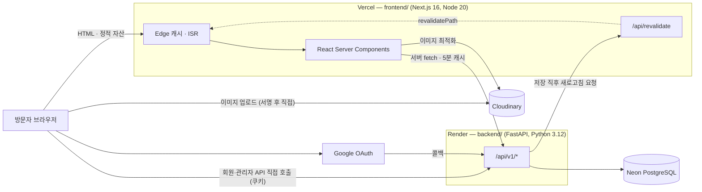
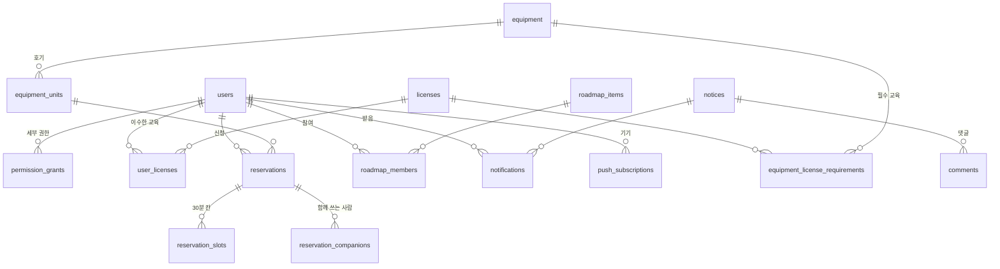

# SHAPE 웹 구조

이 문서 하나만 읽고도 `shape_web` 에서 작업을 시작할 수 있도록 쓴 지도입니다.
Claude·Codex 같은 도구가 저장소를 처음 열었을 때 가장 먼저 읽을 문서를 의도했습니다.

관련 문서와 역할이 겹치지 않게 나눠 두었습니다.

| 문서 | 다루는 것 |
|---|---|
| **이 문서** | 무엇이 어디에 있고, 요청이 어떤 경로로 흐르는가 |
| [`setup.md`](setup.md) | 외부 서비스 연결 절차, 배포 설정, 첫 운영 준비 순서 |
| [`free-tier-deployment.md`](free-tier-deployment.md) | 무료 한도를 지키는 캐시·비용 규칙과 실측 용량표 |
| [`../README.md`](../README.md) | 로컬에서 띄우는 방법 |

---

## 0. 먼저 — 모든 수정은 모바일을 함께 본다

**이 저장소에서 화면을 건드리는 모든 변경은 좁은 화면에서 어떻게 되는지 함께
확인해야 합니다.** 데스크톱에서 잘 보이는 것만 보고 끝내지 마세요. 운영자가
반복해서 지적한 사항이고, 실제로 가장 자주 나온 누락입니다.

바꾸기 전에 확인할 것:

| 확인 | 왜 |
|---|---|
| 360~430px 폭에서 넘치거나 잘리는 곳이 없는가 | 국내 사용 기기의 대부분이 이 폭입니다 |
| 홈처럼 한 화면이 한 장인 구조에서 한 장이 화면 높이를 넘지 않는가 | 넘치면 다음 장이 반쯤 보이는 어정쩡한 상태가 됩니다 |
| 표·격자·가로로 긴 요소가 단을 줄이거나 가로 스크롤 상자로 바뀌는가 | 본문이 가로로 밀리면 페이지 전체가 흔들립니다 |
| 손가락으로 누를 대상이 충분히 큰가 | 마우스 기준으로 만든 작은 버튼은 휴대폰에서 못 누릅니다 |
| 글자가 조금 넓어져도 버티는가 | 뒤의 **글꼴** 항을 보세요. 여유가 십몇 픽셀뿐인 칸은 다른 컴퓨터에서 무너집니다 |

**높이를 다룰 때 `svh` 와 `dvh` 를 구분해 쓰세요.** `svh` 는 주소 표시줄이 나와
있는 가장 좁은 상태의 높이라 **안쪽 글자와 여백**을 묶는 데 씁니다. `dvh` 는
지금 보이는 높이를 따라가므로 **섹션 자체의 높이**에 씁니다. 고정 픽셀로 여백을
쌓으면 사파리에서 표시줄이 접혔다 펴질 때 첫 화면이 잘립니다.

새 CSS 를 넣을 때 데스크톱 규칙만 쓰고 반응형 분기를 빠뜨리는 것이 가장 흔한
실수입니다. 보고하기 전에 스스로 한 번 더 확인하세요.

### 눈대중으로 하지 말고 실제 브라우저로 재세요

여백을 어림해서 줄이면 거의 맞지 않습니다. 실제로 재어 보니 홈의 네 장이 모두
52~273px 넘치고 있었고, 머리글이 첫 내용을 최대 74px 가리고 있었습니다.
둘 다 눈대중으로는 보이지 않던 것입니다.

Playwright 는 `frontend` 의 devDependency 에 들어 있습니다(`editor-probe.mjs` 와
`responsive-audit.mjs` 가 씁니다). 브라우저 본체만 한 번 받으면 됩니다.

```bash
cd frontend && npx playwright install chromium firefox webkit
```

**폭·높이별 점검은 손으로 하지 말고 `scripts/responsive-audit.mjs` 를 돌리세요.**
개발 서버를 띄운 뒤 주소만 주면, 32:9 울트라 와이드부터 320px 휴대폰까지 열네
가지 크기를 훑으면서 캡슐이 두 줄로 접힌 곳, 가로로 밀려 나간 글, 잘린 글,
홈에서 한 장이 화면을 넘은 곳을 찾아 줍니다. `BROWSER=firefox|webkit`,
`BLOCK_FONT=1`(글꼴을 못 받아 온 순간), `FAKE_SESSION=1`(로그인 화면)로 조건을
바꿉니다.

```bash
npx next dev -p 3100 &
node scripts/responsive-audit.mjs http://localhost:3100
```

**관리자 페이지는 `scripts/admin-audit.mjs` 가 따로 있습니다.** `/admin` 은 로그인해야
보이는 데다 탭이 스물일곱이고 주소에 남지 않아 눈으로 훑기가 어렵습니다. 이 도구가
개발 모드의 미리보기로 들어가 탭을 하나씩 눌러 가며 같은 것을 잽니다. 관리자 창구는
쿠키가 없으면 답하지 않으므로 `scripts/admin-sample.mjs` 의 흉내 낸 자료를 대신 넣는데,
그 자료는 **글과 사람이 쌓인 뒤**를 기준으로 만들어 두었습니다(회원 34명, 예약 28건,
수정 기록 50건, 부원 84명, 아주 긴 이름과 이메일). 지금 자료가 적어서 괜찮아 보이는
화면을 통과시키지 않기 위해서입니다.

```bash
node scripts/admin-audit.mjs http://localhost:3100
```

재는 요령 두 가지가 있습니다.

* **스냅 자리 기준으로 재세요.** 머리글이 92px 이고 `scroll-padding-top` 이
  걸려 있으므로, 첫 장을 뺀 나머지 장이 들어갈 자리는 `화면 높이 − 92px` 입니다.
* **`scrollIntoView()` 로 옮기세요.** `window.scrollTo(offsetTop)` 은
  `scroll-padding-top` 을 무시해서, 멀쩡한 화면도 머리글에 가린 것처럼 보입니다.

크롬을 `--headless --screenshot --window-size=` 로 직접 부르면 **500px 아래를
못 냅니다**(맥의 창 폭 하한). 390px 을 보려면 Playwright 로 뷰포트를 지정하세요.
`newContext({ viewport: { width: 390, height: 844 } })` 는 하한이 없습니다.

WebGL 캔버스는 `preserveDrawingBuffer` 없이 `drawImage` 로 읽으면 빈 화면이
나옵니다. 로봇이 그려졌는지 볼 때는 **화면 캡처**(`locator.screenshot()`)를
쓰세요. 캡처는 합성된 프레임을 담습니다.

---

## 1. 전체 구성



세 서비스 모두 무료 티어입니다. 이용자는 20~70명 규모이며, **비용을 좌우하는 것은
전송량이 아니라 요청 수**입니다. 자세한 수치는 `free-tier-deployment.md` 를 보세요.

### 도메인

| 주소 | 가리키는 곳 |
|---|---|
| `www.snu-shape.com` | Vercel (프런트엔드) |
| `snu-shape.com` | `www` 로 308 리다이렉트 |
| `api.snu-shape.com` | Render (백엔드) |

프런트엔드와 백엔드가 **서로 다른 출신지**라는 점이 구조 전반을 결정합니다.
쿠키는 `COOKIE_DOMAIN` 으로 상위 도메인에 걸고, CORS 는 `FRONTEND_URL` 하나만
허용하며, 모든 회원용 요청은 `credentials: "include"` 로 나갑니다.

---

## 2. 요청이 흐르는 세 가지 길

작업하기 전에 지금 만지는 화면이 셋 중 어디에 속하는지 먼저 판단하세요.
캐시 정책과 인증 방식이 전혀 다릅니다.

### (가) 공개 페이지 — 서버에서 그리고 CDN 이 들고 있음

`/`, `/about`, `/news`, `/members`, `/equipment`, `/roadmap`, `/links`, `/shape-up` 등.

1. Next.js 서버 컴포넌트가 `src/lib/api.ts` 의 `api.*()` 로 백엔드를 호출합니다.
   이 fetch 는 `next: { revalidate: 3600 }` 이라 **한 시간 동안 Next.js Data Cache**
   에 남습니다.
2. 그 호출이 백엔드까지 갔더라도 `app/cache.py` 의 공개 응답 캐시가 한 번 더
   막아 줍니다. 같은 길이의 창을 쓰되, 만료가 한 순간에 몰리지 않게 창구마다
   30초 안에서 흩어 두고, 같은 창구는 하나만 채우고 나머지는 기다립니다.
3. 그린 HTML 은 Vercel Edge 캐시에 올라가고, 방문자는 대부분 CDN 에서 받습니다.
   빌드 출력의 `○`(정적) 또는 `●`(경로별 정적)가 이 상태입니다.
4. 관리자가 무언가 저장하면 백엔드가 자기 캐시를 버리고 `POST /api/revalidate` 로
   알려 주어, 해당 경로가 즉시 새로 그려집니다.
   (`app/services/revalidate.py` ↔ `src/app/api/revalidate/route.ts`)

> **한 시간이라는 값은 느슨해서가 아니라, 저장이 그 자리에서 새로 고치기 때문에
> 고를 수 있는 값입니다.** 이 재검증 경로를 끊으면 그 순간 한 시간짜리 지연이
> 진짜 지연이 됩니다. 그래서 `refresh()` 는 실패하면 한 번 더 두드립니다.
>
> **회원이 보는 화면은 이 이야기와 무관합니다.** 게시판·예약·마이페이지·관리자는
> 세션 쿠키가 실려 오므로 캐시를 통째로 비켜 가고, 늘 그 순간의 값입니다.
>
> **왜 한 시간인가.** Neon 무료 compute 는 월 100 CU-시간이고 5분만 놀면 잠듭니다.
> 재검증 주기가 5분이던 동안에는 방문이 이어지는 내내 데이터베이스가 깨어 있어서,
> 베타 이용자 다섯 명만으로 한도의 64% 를 쓰고 있었습니다. 자세한 계산은
> [`free-tier-deployment.md`](free-tier-deployment.md) 에 있습니다. 이 값을 다시
> 줄이려면 그 문서의 실측표를 먼저 보세요.

상세 페이지(`/news/[id]`, `/equipment/[id]`, `/shape-up/[id]`)는 `generateStaticParams`
로 빌드 때 미리 그려 둡니다. 목록을 못 받아 오면 빈 배열을 돌려주므로, 배포 중
백엔드가 자고 있어도 빌드가 깨지지 않고 그 주소는 예전처럼 그때그때 그려집니다.

### (나) 회원 화면 — 브라우저가 백엔드를 직접 호출

`/mypage`, `/notices`, `/equipment/reserve`, `/equipment/status`, `/resources`.

서버에서 그리지 않습니다. 클라이언트 컴포넌트가 `fetch(API_URL + …, { credentials: "include" })`
로 백엔드를 직접 부르고, 백엔드는 `shape_session` 쿠키로 신원을 확인합니다.
이 응답은 전부 `private, no-store` 입니다.

### (다) 관리자 화면 — `/admin` 한 페이지

`src/components/admin-console.tsx` 하나가 모든 관리 기능을 담고 있습니다(약 2,000줄).
탭마다 `/api/v1/admin/*` 을 호출하며, 각 요청은 백엔드에서 권한을 다시 확인합니다.
**프런트엔드의 탭 노출은 편의일 뿐 보안 경계가 아닙니다.**

장비 예약 쪽은 탭 셋으로 나뉩니다. 성격이 다르기 때문입니다.

| 탭 | 하는 일 |
| --- | --- |
| **장비예약 관리** | 부원이 올린 신청을 확정·반려합니다. 겹친 신청만 맨 위에 모입니다. 매일 보는 곳입니다 |
| **관리자 장비예약** | 운영진이 직접 정기 예약을 잡고, 시간대를 막고, 예약 규칙을 정합니다. 학기에 몇 번 쓰는 곳입니다 |
| **라이선스 부여** | 교육 하나를 고르고 이수자를 한 번에 체크합니다. 목록을 통째로 맞추는 방식이라 체크를 풀면 회수됩니다 |

예전에는 정기 예약이 예약 심사 화면 **맨 아래에 접힌 채** 있어서, 학기 일정을 잡으러
온 사람은 그 기능이 있는 줄도 몰랐습니다. 매일 보는 목록과 가끔 정하는 설정을 한
화면에 섞으면 뒤쪽이 반드시 묻힙니다.

---

## 3. 백엔드 — `backend/`

```
backend/
├── app/
│   ├── main.py          FastAPI 앱과 미들웨어 4겹
│   ├── config.py        환경변수 → Settings (lru_cache 로 한 번만 읽음)
│   ├── database.py      비동기 엔진과 세션. Neon URL 정규화가 여기 있음
│   ├── models.py        SQLAlchemy 테이블 정의
│   ├── schemas.py       Pydantic 입출력 모델 (camelCase 로 나감)
│   ├── security.py      세션 쿠키, 권한 확인 의존성
│   ├── middleware.py    요청 크기·유량 제한과 캐시 헤더
│   ├── routers/         auth · public · member · media · admin
│   └── services/        content · link_preview · notifications · reservations · revalidate
├── alembic/versions/    스키마 이력
├── scripts/             시드와 이관 스크립트 (5절)
└── tests/test_api.py    전 기능 통합 테스트 46개
```

### 미들웨어는 바깥부터 이 순서로 겹칩니다

`main.py` 의 `add_middleware` 는 **나중에 붙인 것이 바깥**입니다. 실제 순서는

```
CORS → Session → CostGuard → GZip → 라우터
```

* **CORS** — `FRONTEND_URL` 한 곳만 허용. `allow_credentials=True` 라 와일드카드를 쓸 수 없습니다.
* **Session** — Google OAuth 의 state 를 담는 서명 쿠키.
* **CostGuard** (`middleware.py`) — 이 프로젝트에서 가장 중요한 미들웨어입니다.
  * 본문이 `MAX_REQUEST_BYTES`(2MB)를 넘으면 **DB 세션을 열기 전에** 413 으로 거절합니다.
  * 분당 공개 읽기 120회 / 쓰기 20회로 제한합니다. **로그인한 회원은 계정별로,
    나머지는 주소별로** 셉니다. 학교 Wi-Fi 처럼 여러 명이 한 IP 를 쓰는 곳에서
    서로의 한도를 깎지 않게 하기 위해서입니다.
  * 응답에 `Cache-Control` 을 붙입니다. **허용 목록 방식**이고(`PUBLIC_READS`),
    **세션 쿠키가 실린 요청은 공개 읽기라도 `private, no-store`** 로 내려갑니다.
    `/shape-up` 처럼 같은 주소인데 보는 사람에 따라 `canEdit` 이 달라지는 응답이
    있기 때문입니다.
* **GZip** — 500바이트 넘는 응답을 압축. 한글 JSON 은 `\uXXXX` 로 나가 55~68% 줄어듭니다.
  앞단에 프록시가 없어 앱이 직접 합니다.

> 공개 읽기 경로를 새로 만들면 `PUBLIC_READS` 에 넣어야 캐시가 붙습니다.
> 반대로, 보는 사람에 따라 내용이 달라지는 응답을 그 목록에 넣으면 안 됩니다.

### 권한 모델

두 층으로 되어 있습니다.

| 층 | 값 | 확인 지점 |
|---|---|---|
| 계정 상태 | `PENDING` / `APPROVED` / `VIEWER` / `REJECTED` / `SUSPENDED` | `approved_user`(쓰기) · `reading_user`(읽기) |
| 소유자 | `users.is_owner` | `owner_only` |
| 세부 권한 | `permission_grants.permission` 문자열 | `require_permission("…")` |

**등급은 세 갈래입니다.** 운영진은 owner(모든 확인을 통과), 준회원·정회원은
`APPROVED`, 멤버는 `VIEWER` 입니다.

> **`VIEWER` 는 읽기만 합니다.** 회원 전용 화면에 들어와 공지·자료실·예약 현황을
> 읽되 글쓰기·댓글·예약 신청은 하지 않습니다. **읽는 창구에는 `reading_user`,
> 무언가를 남기는 창구에는 `approved_user`** 를 씁니다. 새 창구를 만들 때 이
> 둘을 헷갈리면 보기 전용 회원이 글을 쓰거나(느슨) 아예 못 들어옵니다(빡빡).
> 화면 쪽에서도 단추를 감춰야 합니다 — 눌러 봐야 서버가 막으므로 없는 편이 낫고,
> 그 자리에 `.read-only-note` 로 왜 없는지 적습니다.

> **owner 는 여러 명일 수 있습니다.** 예전에는 `INITIAL_OWNER_EMAILS` 에 적힌
> 계정만 owner 가 되어, 회장이 바뀌면 환경변수를 고치고 다시 배포해야 했습니다.
> 이제 기존 owner 가 `PATCH /admin/users/{id}/owner` 로 지명합니다. 지명하면
> 관리 권한도 함께 채워집니다. 자기 자신은 내릴 수 없고, 마지막 owner 도
> 내릴 수 없습니다.

쓰이는 권한 문자열은 `content:manage`, `news:manage`, `notices:manage`,
`equipment:manage`, `roadmap:manage`, `links:manage`, `reservations:manage` 입니다.
**owner 는 모든 확인을 무조건 통과**합니다(`has_permission` 첫 줄).

### 데이터 모델



읽기 전용에 가까운 표는 위 그림 밖에 있습니다: `content_pages`(슬러그별 편집 페이지),
`news_posts`, `related_links`, `shape_up_posts`, `resources`.

기억해 둘 만한 설계 두 가지:

* **JSON 컬럼은 제자리에서 고치면 저장되지 않습니다.** `page.content_json["members"]`
  안의 사전을 직접 바꾸고 커밋하면 SQLAlchemy 가 바뀐 줄 모르고 UPDATE 를 내보내지
  않습니다(이 저장소에서 실제로 겪었습니다). 새 값을 만들어 통째로 넣으세요.
* **`UtcDateTime`** (`models.py`) — 모든 시각 컬럼은 저장과 조회 양쪽에서 UTC 로
  맞춥니다. 로컬 개발용 SQLite 가 시간대를 떼어 버려 화면에서 9시간씩 어긋나던
  문제를 막습니다. 새 시각 컬럼도 반드시 이 타입을 쓰세요.
* **`reservation_slots`** — 승인된 예약을 30분 칸으로 펼쳐 `(호기, 시작시각)` 에
  고유 제약을 겁니다. **겹침 방지는 애플리케이션 로직이 아니라 데이터베이스 제약**
  이 책임집니다. 신청 단계에서 미리 걸러 주기는 하지만 최종 방어선은 이 제약입니다.
  겹침을 막는 기준이 **사람이 아니라 호기**라는 점도 여기서 나옵니다. 한 사람이
  로봇 팔과 GPU 워크스테이션을 같은 시간에 함께 잡는 것은 정상이고, 실제로 흔합니다.
* **예약의 `note` 는 예전 이름이 `purpose` 였습니다.** 지금은 목적이
  `purpose_category`(대회·SHAPE-UP·교육·기타)로 따로 있고, `note` 는 "왜 하필 이
  시간이어야 하는가" 를 적는 선택 입력입니다. 시간이 겹쳤을 때 운영진이 실제로
  읽는 곳이라, 동아리 전체가 보는 예약 현황 달력에는 싣지 않습니다.
* **`EXPIRED`** — 아무도 손대지 않은 채 사용 시간이 지나간 신청입니다. `CANCELLED`
  로 뭉뚱그리면 '사람이 물린 것' 과 '그냥 지나간 것' 이 관리자 목록에서 구분되지
  않습니다.

### 예약은 대부분 저절로 확정됩니다

규칙은 하나이고 `services/reservations.py` 의 `try_auto_approve` 한 곳에 있습니다.

> **대기 신청은, 시작까지 정해 둔 시간 이하로 남았고 같은 호기·같은 시간에 다른
> 대기 신청이 없으면 확정된다.**

그 '정해 둔 시간' 은 기본 한 시간이고 **관리자 화면에서 바꿉니다**(아래 '예약 규칙은
코드가 아니라 화면에서 정합니다'). 코드의 상수는 설정 행이 아직 없을 때의 기본값일
뿐이라, 새로 값을 읽는 자리를 만들 때는 상수가 아니라
`reservation_policy.current(db)` 를 쓰세요.

신청하는 순간 이미 그 안이면(장비 앞에 서서 지금 칸을 잡는 흔한 경우) 신청과 동시에
확정됩니다. 그래서 같은 함수를 `POST /reservations` 직후와 훑기 양쪽에서 부릅니다 —
규칙이 한 곳에만 적혀 있어야 두 경로가 어긋나지 않습니다.

**겹치면 손대지 않습니다.** 자동으로 한쪽을 고르면 '먼저 신청한 사람' 이 아니라
'단추를 늦게 누른 사람' 이 이기는 규칙이 됩니다. 겹친 것은 사람이 봅니다 — 관리자
화면이 그 묶음을 맨 위에 따로 모아 보여 줍니다.

**자동 승인은 기본 경로가 아니라 안전망입니다.** 신청 즉시 운영진에게 알림이 가고,
평소처럼 먼저 확정해도 됩니다. 아무도 손대지 않았을 때만 시계가 대신 누릅니다.

`services/reservation_sweeps.py` 가 자동 확정과 자동 만료를 맡습니다. 알림만 만드는
`reservation_alerts.sweep_due` 와 **섞지 않았습니다** — 그쪽은 상태를 바꾸지 않고,
커밋 경계도 다릅니다. 둘 다 크론 없이 `middleware` 가 로그인한 사람의 요청에 얹어
같은 세션에서 부릅니다. 아무도 들어오지 않는 새벽에는 늦어지지만, 쓰러 오는 사람
본인의 접속이 훑기를 깨우므로 장비 앞에 선 순간에는 거의 항상 처리되어 있습니다.

### 지금 돌고 있는 칸도 예약할 수 있습니다

17시 14분에 17~18시 칸을 잡는 것은 정상입니다 — 사람이 장비 앞에 서서 신청하기
때문입니다. 막는 것은 둘뿐입니다: **이미 끝난 시간**(`ends_at <= now`)과 **지금 칸보다
앞선 칸**(`starts_at < block_floor(now, 예약단위)`). 화면도 **끝 시각이 지났을 때만**
칸을 잠급니다(`lib/booking.ts` 의 `slotState`). 두 규칙이 어긋나면 눌리는데 거절되거나
받아 주는데 눌리지 않는, 어느 쪽이든 설명할 수 없는 화면이 됩니다.

승인 쪽 기준도 `starts_at` 이 아니라 `ends_at` 입니다. 17~18시 예약을 17시 40분에
확정하는 것은 여전히 쓸모가 있고, 승인이 늦었다는 이유로 남은 20분까지 버릴 이유가
없습니다.

### 운영진은 시간대만 골라 막을 수 있습니다

`reservation_blackouts` 표와 `services/blackouts.py`. 예전에는 시간을 막는 수단이
장비 **전체**를 `MAINTENANCE` 로 돌리는 것뿐이라, 목요일 저녁 교육 실습 때문에
SO-ARM 을 막으면 나머지 엿새까지 함께 닫혔습니다. 그래서 실제로는 아무도 그 방법을
쓰지 못했고, "그 시간대 개인 예약은 피해 주세요" 라는 문장이 장비 설명에 **글로만**
남아 있었습니다.

규칙의 모양은 **하나뿐**입니다 — 요일 집합 + 시각 범위 + 날짜 범위. 하루만 막는 것은
시작 날짜와 끝 날짜를 같은 날로 두는 경우이고, 사흘 내리 막는 것은 요일 일곱 개를 모두
고르고 시각을 0~24시로 두는 경우입니다. 모양이 하나면 겹침을 따지는 코드도, 관리자
화면도 하나뿐입니다.

* **시각은 한국 시각 자정에서부터 잰 분**(`start_minute`·`end_minute`)입니다. UTC 로
  재면 날짜 경계가 아홉 시간 밀려 "목요일 19시" 가 수요일로 넘어갑니다.
* **호기를 비우면 그 장비의 모든 호기**를 막습니다. 카메라 7호기 중 하나만 정비하는
  경우가 있어 호기를 지정할 수 있게 두었습니다.
* 막힌 시간은 **신청(`create_pending`)·승인(`approve`)·정기 예약** 세 자리에서 모두
  거절합니다. 정기 예약은 `create_pending` 을 거치지 않고 예약을 직접 만들기 때문에
  거기서 따로 봅니다.
* 예약 가능 시간 창구는 막힌 칸을 `blockedStarts` 로, 사유를 `blockedReasons` 로
  함께 돌려줍니다. 화면은 그 칸을 누를 수 없게 그리고 사유를 적습니다 — 왜 못
  누르는지 말해 주지 않으면 부원은 결국 운영진에게 물어보게 됩니다.
* **막을 때 걸리는 예약은 미리 보여 주고 함께 취소합니다.** `POST /admin/blackouts`
  는 `cancelConflicts` 없이는 거절합니다. 미리보기를 보지 않은 호출이 남의 확정
  예약을 조용히 물리는 길을 열어 두지 않기 위해서입니다. **사용 중인 예약은 건드리지
  않습니다** — 이미 사람이 장비 앞에 서 있는데 예약만 사라지면 기록과 실제가 어긋납니다.
* **예약 현황 달력에도 함께 그립니다.** `GET /equipment/blackouts?month=` 이 요일
  규칙을 그 달의 날짜마다 펼쳐 줍니다. 달력에 없으면 부원은 빈 칸을 보고 예약
  화면까지 갔다가 거기서야 막힌 것을 알게 됩니다. 펴는 일을 서버가 맡는 이유는,
  화면이 다시 펴게 하면 같은 계산이 두 곳에 생기고 한쪽만 고쳐지는 날이 오기
  때문입니다. 이 창구는 `/equipment/{equipment_id}/availability` 와 조각 수가
  달라 겹치지 않지만, 나중에 `{equipment_id}` 하나짜리 창구를 만들면 반드시
  그보다 **먼저** 선언해야 합니다.
* `services/blackouts.py` 는 `services/reservations.py` 를 **가져오지 않습니다**.
  반대 방향으로만 의존해야 import 가 원을 그리지 않습니다. 30분 칸을 펴는 짧은
  반복이 양쪽에 하나씩 있는 것은 그 때문입니다.

### 예약 규칙은 코드가 아니라 화면에서 정합니다

`reservation_policy` 표(행이 하나뿐)와 `services/reservation_policy.py`. 자동 확정
시점, 운영진 독촉 시점, 사용 시작 여유, 사진 독촉, 한 건 최대 시간, 예약 가능 기간,
정기 예약 최대 건수 — 일곱 개가 모두 파이썬 상수였습니다. 그래서 자동 확정을 한
시간에서 두 시간으로 바꾸는 일에도 코드 수정과 배포가 필요했고, 정작 운영을 맡은
사람이 스스로 조절할 수 없었습니다.

* **행이 하나뿐이므로 `id` 를 정수 1 로 고정**합니다. UUID 를 쓰면 "어느 행이
  진짜인가" 를 매번 정해야 하는데, 설정은 하나여야 뜻이 분명합니다.
* **읽는 쪽은 표를 만들지 않습니다.** 행이 없으면 코드의 기본값을 그대로 씁니다.
  공개 읽기가 데이터베이스에 쓰기를 하면 안 되기 때문입니다. 행은 관리자 화면이
  처음 열릴 때 만들어집니다.
* 값은 예약 창구마다 읽히므로 **1분 동안 프로세스 안에 들고 있습니다**(`TTL`).
  저장할 때 `forget()` 이 버리므로 고친 값이 곧바로 보이지만, 서버가 여럿이면 다른
  프로세스는 최대 1분 옛 값을 씁니다. 설정 값의 성질상 그 지연은 문제가 되지 않습니다.
* **부원 화면도 이 값을 읽습니다** — `GET /reservation-policy`(공개, 캐시됨)가
  자동 확정 시점 등을 돌려주고, 예약 화면과 안내 팝업이 "한 시간" 대신 그 값을
  적습니다. 화면에 숫자를 박아 두면 정책을 바꾼 뒤 안내가 옛말을 하게 됩니다.
  실리는 것은 규칙 값뿐이라 누가 부르든 같은 응답이고, 그래서 공개 캐시에 올라갑니다.

### 부원에게는 규칙이 아니라 '내 신청' 의 시각을 알려 줍니다

"같은 시간에 다른 신청이 없으면 시작 한 시간 전에 저절로 확정됩니다" 는 규칙일 뿐,
**내 신청이 어느 쪽인지는 말해 주지 않습니다.** 그러면 부원은 결국 운영진에게 직접
물어보게 됩니다. 그래서 두 곳에서 시각을 계산해 적습니다.

* **신청하기 전** — 예약 화면에서 시간을 고르면 곧바로 "지금 신청하면 곧바로
  확정됩니다" 또는 "8월 30일 13:00에 저절로 확정됩니다" 가 붙습니다
  (`lib/booking.ts` 의 `confirmOutlook`). 겹친 칸은 대기 수를 세어 화면이 스스로
  판정합니다.
* **신청한 뒤** — `ReservationRead` 에 `autoConfirmAt` 과 `contested` 가 실립니다.
  겹쳤는지는 **내 예약 목록만으로는 알 수 없어**(남의 신청이 보이지 않습니다) 서버가
  판정합니다. `read_models` 가 대기 신청이 하나라도 있을 때만 질의를 한 번 더 합니다.

시각은 어디서나 **24시간제**로 적습니다. 설정을 `lib/booking.ts` 의
`CLOCK_OPTIONS` 한 곳에 두고 마이페이지·예약 현황 달력·지금 쓸 예약 띠·관리자 심사
화면이 모두 가져다 씁니다. 시간표가 `19:00` 눈금인데 안내만 `오후 7:00` 이면 같은
시각이 자리마다 달라 보이고, 한 카드 안에서 두 형식이 섞이기도 합니다.

화면은 **서버가 거절할 값을 고를 수 있게 두지 않습니다.** 예약 가능 기간은 날짜
입력의 `max` 와 주간 띠의 잠금으로, 한 건 최대 시간은 칸을 늘릴 때 막습니다. 두 값
모두 정책에서 읽으므로 관리자가 바꾸면 화면도 따라 바뀝니다.

### 사용을 일찍 마치면 남은 시간이 풀립니다

예전에는 사용 후 사진을 올려 `COMPLETED` 가 되어도 확정 슬롯이 끝 시각까지 그대로
남아, 17~19시를 잡고 17시 10분에 끝내도 19시까지 아무도 그 장비를 쓸 수 없었습니다.
지금은 사진을 올릴 때 남은 시간을 반납할 수 있습니다(`release_remaining`). 끝 시각은
**다음 30분 눈금으로 올려** 잡습니다 — 내림으로 자르면 이미 쓴 칸이 빈 칸으로 돌아가
다른 사람이 그 위에 겹쳐 잡을 수 있습니다.

### 승인된 AI Worker 예약은 공유 구글 캘린더에도 올라갑니다

`services/google_calendar.py`. 예약이 **확정되면** 동아리가 함께 쓰는 '휴머노이드 운용'
구글 캘린더에 같은 일정이 올라가고, **취소되면** 지워집니다. 그 캘린더는 SHAPE 만 보는
곳이 아니라 장비를 같이 쓰는 다른 분들도 보는 곳이라, 예전에는 사이트에 신청한 뒤
캘린더에 같은 일정을 손으로 한 번 더 적었습니다. 두 번 적으면 빠뜨리거나 어긋납니다.

알아 둘 것이 넷 있습니다.

* **AI Worker 만 보냅니다**(`google_calendar.EQUIPMENT`). 그 캘린더는 이름 그대로
  휴머노이드 장비의 일정을 보는 곳이라, 다른 장비까지 올리면 남의 달력을 우리가
  채우게 됩니다.
* **일정 번호를 저장하지 않습니다.** 예약 id 에서 계산해 냅니다
  (`shape` + UUID 의 16진수 — 구글은 일정 id 로 `0-9a-v` 만 받는데 16진수는 그 안에
  들어갑니다). 새 컬럼이 필요 없고, 무엇보다 "캘린더에는 만들었는데 번호를 저장하기
  전에 죽는" 어중간한 상태가 생기지 않습니다.
* **붙이는 자리는 `services/reservations.py` 의 `approve` 와 `cancel` 한 곳씩입니다.**
  관리자가 취소한 것과 본인이 마이페이지에서 취소한 것이 같은 길을 타야 합니다.
  라우터에 나눠 붙이면 한쪽만 고치고 다른 쪽을 잊게 됩니다.
* **실패해도 예약은 성공입니다.** 구글에 보내는 일은 `revalidate` 와 같은 방식으로
  요청과 떼어 보내고, 실패하면 기록만 남깁니다. 캘린더가 안 된다고 승인이 막히는
  쪽이 더 나쁩니다.

제목은 `SHAPE: 장하람 AI WORKER 오후 2:30~8시` 입니다. **그 캘린더에 이미 손으로 적혀
쌓인 일정과 같은 모양**이어야 하므로, 형식을 바꾸려면 캘린더를 먼저 확인하세요.
열쇠(`GOOGLE_SERVICE_ACCOUNT_JSON`)와 캘린더 ID(`GOOGLE_CALENDAR_ID`)는 Render 환경
변수로만 옵니다. 둘 중 하나라도 없으면 이 기능만 조용히 쉬어 가므로, 로컬 개발과 자동
시험이 남의 달력을 건드리지 않습니다.

### 라우터가 나뉜 기준

| 라우터 | 인증 | 내용 |
|---|---|---|
| `auth.py` | — | Google OAuth 시작·콜백, 세션 조회, 로그아웃, 내 프로필 |
| `public.py` | 없음 | 공개 페이지가 읽는 것 전부 |
| `member.py` | 승인 회원 | 게시판, 예약, 알림, 자료실, SHAPE-UP, 내 로드맵 |
| `media.py` | 승인 회원 | Cloudinary 업로드 서명 발급 |
| `admin.py` | 권한별 | 관리 기능 전부 |

`/resources` 와 `/shape-up` 은 `optional_user` 를 써서 **로그인 여부에 따라 응답이
달라집니다**. 이 둘을 건드릴 때는 위의 캐시 규칙을 꼭 함께 확인하세요.

### 부원 카드와 구글 계정은 하나로 이어집니다

부원 한 명에 두 곳이 관여합니다. **부원 카드**(`content_pages/members` 의
`content_json.members[]`)는 운영진이 이름·팀·역할·소속을 적는 자리이고,
**구글 계정**(`users`)은 본인이 사진과 소개말을 관리하는 자리입니다. 카드의
`userId` 가 둘을 잇습니다.

> **연결된 카드는 사진과 소개말을 계정에서 가져옵니다.** 예전에는 상세 대화창만
> 그랬고 카드 격자는 카드에 저장된 사진을 써서, 계정을 연결해 두고도 두 사진이
> 갈렸습니다. 지금은 `member-directory.tsx` 의 `photoOf()` 한 곳이 정합니다.
> 이름·팀·역할·소속은 계속 운영진이 관리합니다. 구글 계정 이름은 영문이거나
> 이메일 앞부분인 경우가 있어 그대로 쓰면 부원 페이지가 흐트러집니다.

**아직 로그인하지 않은 부원** 은 카드에 저장된 사진을 그대로 씁니다.

> **연결은 본인이 합니다. 운영진이 하나씩 맞추지 않습니다.** 로그인하면
> 마이페이지 › ‘내 부원 카드’ 에 **이름이 같은** 미연결 카드가 후보로 뜨고,
> 본인이 고르면 붙습니다. 마흔 장을 운영진이 손으로 맞추는 것보다 정확하고,
> 새 부원이 들어와도 저절로 이어집니다.

| 하는 일 | 어디서 | API |
| --- | --- | --- |
| 내 카드·후보 보기 | 마이페이지 | `GET /auth/me/member-card` |
| 내 카드로 연결 | 마이페이지 | `POST /auth/me/member-card` |
| 연결 놓기 | 마이페이지 · 관리자 | `DELETE /auth/me/member-card` |

집을 수 있는 카드는 **이름이 같고 아직 아무도 집지 않은** 것뿐입니다. 이름이
다르면 403, 남이 이미 집었으면 409 입니다. 한 계정은 카드 하나만 가지므로 다른
카드를 집으면 앞의 것은 저절로 놓입니다. 집을 때 **카드 사진이 있고 내 계정
사진이 아직 구글에서 가져온 것 그대로이면(`googleusercontent.com`) 카드 사진을
계정 사진으로 삼습니다.** 두 프로필이 갈려 보이던 것을 하나로 모으는 자리가
여기입니다.

관리자 › 부원 탭에는 **고르는 자리가 없습니다.** 연결 현황과 미연결 명단을
보여 주고, 잘못 연결된 카드만 풀어 줍니다.

> **관리자 화면이 공개 응답을 읽을 때는 `cache: "no-store"` 를 붙이세요.**
> `/pages/*` 는 방문자용으로 60초 캐시됩니다. 그냥 읽으면 방금 저장한 값 대신
> 최대 1분 전 응답이 돌아옵니다. 실제로 카드에 계정을 연결하고 저장해도 곧바로
> 다시 풀린 것처럼 보였습니다(서버에는 저장되어 있었습니다).
> `admin-console.tsx` 의 `PUBLIC_READ` 가 그 설정입니다.

### 한 장이 화면에 들어오는지 잴 때는 **그 장을 화면에 띄운 뒤에** 재세요

홈의 각 장에는 아직 화면에 오지 않았을 때 `translateY(30px)` 로 내려 둔 조각이
있습니다(`.home-reveal`). CSS 에서 스크롤 넘침 영역은 변형(transform)까지 포함해
계산하므로, 화면 맨 위에서 `scrollHeight` 를 재면 **아직 오지 않은 장이 16px 쯤
넘치는 것처럼** 나옵니다. 실제로 이 값을 보고 여백을 깎다가 아무 문제 없던 자리를
건드릴 뻔했습니다.

    // 틀림 — 맨 위에서 전부 잰다
    sections.map((s) => s.scrollHeight - s.clientHeight)

    // 맞음 — 장을 화면에 올린 뒤 그 장만 잰다
    s.scrollIntoView({ behavior: "instant", block: "start" });
    await wait(1500);            // 장이 `in-view` 를 받고 변형이 풀릴 때까지
    s.scrollHeight - s.clientHeight

### 데이터베이스 구조는 서버가 뜰 때 스스로 맞춥니다

Render 는 새 코드를 밀어 넣으면 알아서 배포하는데, 마이그레이션은 사람이 따로
실행해야 했습니다. 그 사이에 **새 컬럼을 읽는 코드가 먼저 올라가면 그 기능이
통째로 500** 이 됩니다. 알림에 갈 곳(`url`) 칸을 더할 때 실제로 그럴 뻔했습니다.

지금은 `app/main.py` 의 lifespan 이 뜰 때 한 번 `alembic upgrade head` 를
실행합니다. 무료 티어라 서버가 하나뿐이므로 경쟁이 없습니다. 실패해도 서버는
계속 뜨고 로그에 남깁니다 — 마이그레이션 하나 때문에 사이트 전체가 닫히는 쪽이
더 나쁘기 때문입니다. 로컬과 자동 시험은 SQLite 라 건너뜁니다.

그래도 **마이그레이션은 되돌릴 수 있게 쓰세요.** 자동으로 도는 만큼, 잘못 쓴
마이그레이션은 배포하는 순간 운영 데이터에 닿습니다.

### 사람 이름은 길이를 우리가 정할 수 없습니다

이름은 구글 계정에 적힌 값을 그대로 씁니다. 실제로 `김○○/ 학생/
바이오시스템·소재학부` 처럼 소속까지 적어 둔 분이 있었고, 그 이름이 머리글의
이름 캡슐 안에서 세 줄로 접히면서 머리글 전체가 무너졌습니다(로그아웃 글자까지
세로로 쌓였습니다).

**이름을 그리는 자리에는 반드시 폭 상한과 줄바꿈 금지를 함께 두세요.** 자리가
캡슐(`border-radius:999px`)이거나 고정 높이 줄, 고정 칸 수 격자라면 특히
그렇습니다. 두 가지 방법이 있습니다.

* **캡슐 안** — `components/scrolling-name.tsx` 의 `<ScrollingName name={…} />`
  를 쓰세요. 자리 크기는 그대로 두고 **넘치는 이름만** 그 안에서 가로로
  흘려 보여 줍니다. 넘치지 않는 이름에는 아무 일도 일어나지 않으므로 이름표가
  여러 개 놓인 목록에서도 평소에는 아무것도 움직이지 않습니다. 폭은 쓰는 쪽에서
  `--name-max` 로 정합니다. 움직임 줄이기를 켠 사람에게는 말줄임표로 바뀝니다.
* **그 밖** — `overflow:hidden; text-overflow:ellipsis; white-space:nowrap` 에
  `min-width:0` 을 함께 두세요. 옆에 놓인 아이콘과 버튼에는 `flex:none` 을 주어야
  이름에 밀려 찌그러지지 않습니다.

`white-space:nowrap` 만 준 칸은 **줄바꿈 대신 칸이 늘어납니다.** 게시판 목록의
글쓴이 칸이 그랬고, 이름이 길면 `minmax(0,1fr)` 인 제목 칸을 0 까지 밀어냈습니다.
nowrap 을 줄 때는 폭 상한을 같이 주세요.

### `public/` 안의 사진을 바꾸면 **주소도 바꾸세요**

이미지 최적화 결과를 1년 동안 들고 있습니다(`next.config.ts` 의
`minimumCacheTTL`). 무료 요금제에서 세는 것이 변환 횟수라 일부러 길게 잡은
값입니다. 그런데 캐시의 열쇠는 **주소** 라서, 파일 내용만 바꾸고 주소를 그대로
두면 바뀐 것을 알 길이 없습니다. 장비 사진을 1200×1200 으로 다시 뽑고도 화면에는
옛 사진이 계속 나왔습니다.

파일을 갈아 끼울 때는 **파일 이름** 을 바꾸세요 — `/equipment/omy-3.png`.
주소 뒤에 `?v=3` 을 붙이는 흔한 방법은 여기서 쓸 수 없습니다. **Next.js 이미지
최적화가 로컬 주소에 붙은 물음표를 받지 않습니다**(실측: 400). 장비 사진 주소는
데이터베이스에 들어 있으므로 마이그레이션으로 함께 바꿉니다
(`20260824_equipment_image_rename.py` 가 그 예입니다). 부원 사진(`/figs/…`)은 파일
이름이 곧 사람 이름이라 내용이 바뀌지 않으므로 이 문제가 없습니다.

### 사진은 자리 크기에 맞춰 받아 옵니다

`media(url, width, quality)` 의 세 번째 값이 화질입니다. 크게 놓이는 사진은
`"high"`, 이름 옆 작은 얼굴은 `"eco"` 입니다. 폭은 **화면에 그려지는 CSS 폭 ×
2**(고해상도 화면) 을 기준으로 잡습니다. 우리 폴더에 있는 사진에는 `sizes` 를
꼭 붙이세요 — 없으면 브라우저가 무조건 1920px 짜리를 받아 갑니다.

    // 자리 391px · 2배 화면이면 782px 필요
    <Image src={media(url, 900, "high")} sizes="(max-width: 900px) 90vw, 420px" quality={90} />

재는 방법은 간단합니다. 브라우저에서 `naturalWidth` 와
`getBoundingClientRect().width × devicePixelRatio` 를 견주면 됩니다. 받은 쪽이
작으면 늘려 그리는 것이고, 그게 사진이 뭉개져 보이는 가장 흔한 이유입니다.

### 목록 응답에는 본문을 싣지 마세요

게시판 목록은 게시된 글을 **전부**, 본문까지 담아 보내고 있었습니다. 목록 화면은
제목·분류·글쓴이·날짜·댓글 수만 그리므로 본문은 통째로 버려졌습니다. 게시판은
회원 전용이라 공유 캐시도 태울 수 없어, 글이 쌓이는 만큼 목록을 여는 사람마다
무거운 응답이 나갑니다.

지금은 `NoticeRead`(목록)에 본문이 없고 `NoticeDetailRead`(상세)에만 있습니다.
한 번에 30개까지 보내고, 더 오래된 글은 `?before=<마지막 글의 publishedAt>` 으로
이어 받습니다. 화면의 '이전 글 더 보기' 가 그 자리입니다. 새 목록 API 를 만들 때
같은 두 가지를 확인하세요 — **목록에 본문이 없는가, 개수 상한이 있는가.**

### 올린 사진은 세 단계로 줄어듭니다

무료 티어에서 가장 먼저 닳는 것이 전송량이고, 그 대부분을 글에 박힌 사진이
씁니다. 세 자리에서 줄입니다.

1. **올릴 때** — `src/lib/upload.ts` 의 `shrink()` 가 브라우저에서 가로 1600px,
   WebP 로 바꿔 보냅니다. 실측 638KB → 44KB. 이미 작은 사진과 GIF 는 그대로 둡니다.
2. **저장할 때** — `sanitize_html` 이 본문의 Cloudinary 주소에
   `f_auto,q_auto,c_limit,w_1400` 을 붙이고 `loading="lazy"` 를 답니다.
3. **내보낼 때** — `DeliveredHtml`(schemas.py)이 같은 규칙을 한 번 더 적용합니다.
   규칙이 생기기 전에 저장된 글까지 덮기 위한 자리입니다.

표지 사진은 화면 쪽 `media()` 가 같은 일을 합니다. **편집기가 넣은 주소를 그대로
믿지 마세요.** 원본은 휴대폰 사진 그대로입니다.

### SHAPE-UP 결과물은 논문 프로젝트 페이지 형식입니다

예전에는 본문이 `content_html` 하나짜리 자유 편집기였습니다. 팀마다 글의 모양이
달랐고, 어떤 팀은 결과 그림을 맨 위에 어떤 팀은 맨 아래에 두었습니다. 목록에
여덟 팀이 늘어서면 여덟 가지 서식이 됩니다.

지금은 `openvla.github.io` 류 논문 프로젝트 페이지와 같은 칸으로 나눠 받고,
**차례와 짜임은 화면이 정합니다.** 칸은 초록 · 문제 설정 · 방법(덩이) ·
결과(덩이) · 한계와 다음 과제, 그리고 링크 줄(코드 · 영상 · 발표자료)입니다.
**빈 칸은 제목까지 통째로 화면에 나타나지 않습니다** — 채우지 않은 칸이 빈
제목만 남기고 서 있으면 미완성으로 보입니다.

방법·결과는 `[{image, video, caption}]` 배열입니다. 팀마다 필요한 수가 달라서
개수를 정하지 않고, 각각 열두 덩이까지 받습니다.

#### 글쓰기 도구는 게시판·소식과 같은 것을 씁니다

초록·문제 설정·한계는 `RichTextEditor`(TipTap)로 씁니다. 사이트 안에서 글쓰기
도구가 화면마다 다르면 배우는 것이 두 벌이 되고, 게시판에서 쓰던 표·수식·사진을
결과물에서는 못 쓰게 됩니다. 값이 HTML 이므로 저장할 때 `sanitize_html` 로
걸러 내고, 내보낼 때 `DeliveredHtml` 로 사진 축소 규칙을 한 번 더 붙입니다.
화면은 소식 상세와 같이 `rich-content` 로 그리고 `MathContent` 가 수식을 그립니다.

**나머지는 글자 그대로 둡니다.**

- **한 줄 요약** — 목록 카드와 `<meta description>` 에 그대로 실립니다. 태그가
  섞이면 검색 결과에 태그가 보입니다.
- **덩이 설명** — 그림 아래 한 줄입니다. 제목이나 표가 들어가면 논문 페이지의
  짜임이 깨지고, 방법·결과를 합쳐 스물넷까지 늘어날 수 있어 편집기를 그만큼
  띄우면 휴대폰에서 무겁습니다. 그림도 영상도 없는 덩이는 캡션이 아니라 본문
  크기로 그립니다(`paper-block.text-only`).

본문 안에 넣은 제목은 **칸 제목보다 작게** 그립니다. `.rich-content` 의 기본은
h2 가 32px 인데 칸 제목(초록·방법 …)이 22px 이라, 그대로 두면 팀이 h2 를 하나
넣는 순간 위계가 뒤집힙니다.

#### 영상은 유튜브 주소만 받습니다

Cloudinary 무료 티어는 1크레딧에 HD 250초라 **영상이 크레딧을 가장 빨리
먹습니다.** 우리가 영상 서버를 겸할 이유가 없고, Nerfies 템플릿도 10MB 넘는
영상은 유튜브를 쓰라고 적어 둡니다. 화면과 서버 양쪽에서 막습니다
(`schemas.youtube_only`).

끼워 넣을 때는 `youtube-nocookie.com` 을 씁니다. 공개 페이지라 로그인하지 않은
방문자도 오는데, 재생을 누르기 전부터 추적 쿠키를 심을 이유가 없습니다.
표지 그림을 안 올린 팀의 목록 카드는 **유튜브 미리보기 그림**으로 채웁니다 —
유튜브가 보내 주므로 우리 대역폭을 쓰지 않습니다.

#### 그림 칸에 넣은 유튜브 주소는 영상으로 옮깁니다

한 덩이 안에 주소 칸이 둘입니다 — 그림 올리기의 '또는 이미지 URL' 과 영상 칸.
나란히 있어서 잘못 넣기 쉽고, 그대로 두면 화면이 유튜브 주소를 `` 로 그려
**깨진 그림**이 됩니다(실제로 눌러 보다가 그렇게 났습니다). 넣은 사람의 뜻은
분명하므로 거절하는 대신 서버가 제자리로 옮깁니다. 대표 그림 칸도 같습니다.

#### 목록은 기수별로 묶고 지난 기수는 접습니다

창구는 한 번에 60편까지만 주는데 목록은 이어받기를 쓰지 않고 있었습니다.
학기당 열 편이면 **3년째에 옛 결과물이 목록에서 소리 없이 사라집니다** —
"다음 기수의 자산으로 축적한다"는 목적이 정확히 그 시점에 깨집니다.
`lib/api.ts` 의 `allShapeUp()` 이 서버에서 이어받아 전부 가져오고, 사이트맵과
상세 쪽 미리 그리기도 같은 함수를 씁니다.

접힌 기수의 그림은 브라우저가 받아 오지 않습니다(`loading="lazy"` 가 숨은
요소에 걸립니다). 접혀 있어도 글은 HTML 안에 그대로 있어 검색 엔진은 전부
읽어 갑니다.

#### 그림 주소가 어디 있는지 고아 정리기가 알아야 합니다

`media_sweep` 은 "아무도 안 쓰는 Cloudinary 사진" 을 지웁니다. SHAPE-UP 은
그림 주소가 **네 곳**에 흩어져 있습니다 — 표지, 방법·결과 덩이의 JSON, 그리고
초록·문제 설정·한계 **본문 안에 박힌 것**. 여섯 칸 모두 `COLUMNS` 에 들어
있어야 합니다. 하나라도 빠뜨리면 **쓰이고 있는 그림이 고아로 판정되어
지워집니다.** 시험이 칸 목록까지 확인합니다.

#### 값이 얼마나 드는가 (재 봄)

전달되는 그림 한 장이 62KB(`shrink()` 가 가로 1600 WebP 로 줄여 올립니다).
논문형 페이지 한 장이 대표 1 + 방법 3 + 결과 3 ≈ 7장 430KB 이고 영상은
유튜브에서 옵니다.

| | 학기 10편 · 연 20편 | 무료 한도 |
|---|---|---|
| Cloudinary 저장 | 연 7.4MB · 10년 74MB | 1크레딧 = 1GB (월 25) |
| Cloudinary 대역폭 | 상세 1회 430KB | 월 6만 회 조회까지 |
| Neon | 연 160KB | 0.5GB |

`optimizable()` 이 Cloudinary 주소에 false 를 돌려주므로 **Vercel 이 중계하지
않고 Cloudinary 가 방문자에게 직접 보냅니다.** 그래서 세야 하는 것은 Vercel 이
아니라 Cloudinary 쪽입니다.

### 소식과 언론보도는 같은 표를 나눠 씁니다

둘 다 `news_posts` 이고 `category` 로만 갈립니다. 언론보도는 `"언론보도"`,
나머지가 소식입니다. 그래서 목록을 부를 때 **소식 탭은 `?exclude=언론보도`,
언론보도 탭은 `?category=언론보도`** 로 서로를 뺍니다. 분류 이름은
`src/lib/api.ts` 의 `PRESS_CATEGORY` 한 곳에 있습니다.

거르기를 화면에서 하지 마세요. `limit` 만큼 받아 온 뒤 버리면 한쪽이 늘어나는
만큼 다른 쪽이 목록 밖으로 밀려납니다. 다만 **사이트맵과 상세 페이지 미리
그리기는 전체를 부릅니다.** 언론보도 상세도 검색에 잡히고 CDN 에서 나가야
하기 때문입니다.

---

## 4. 프런트엔드 — `frontend/`

```
frontend/
├── src/app/          App Router. 폴더 = URL
├── src/components/   화면 조각
├── src/lib/          api · media · members · navigation · format · types …
└── public/
    ├── figs/         옛 사이트에서 옮겨 온 부원 사진
    ├── models/       홈 화면 로봇 3D (.glb, 합계 약 1.4MB)
    └── sw.js         푸시 알림과 아이콘 캐시용 서비스 워커
```

### 스타일

전역 CSS 다섯 장을 `layout.tsx` 에서 한꺼번에 불러옵니다
(`globals` → `responsive-additions` → `feature-additions` → `header-fixes` → `site-polish`).
**뒤에 오는 파일이 앞을 덮는 구조**이므로, 스타일이 안 먹으면 뒤쪽 파일에 같은
선택자가 있는지 먼저 보세요. 압축 후 합계 약 33KB 이고 모든 페이지에 실립니다.

### 글꼴은 사이트가 직접 실어 보냅니다 — 92개 조각으로

`font-family` 에 Pretendard·Apple SD Gothic Neo·Noto Sans KR 을 늘어놓고 **보는
사람 컴퓨터에 그 글꼴이 깔려 있기를 기대**하면, 리눅스·윈도에서는 하나도 없어
Arial(리눅스에서는 Liberation Sans)로 떨어집니다. 같은 글이 환경마다 다른 폭으로
그려져 여유가 십몇 픽셀뿐이던 칸이 그대로 무너집니다. 그래서 글꼴 파일을 함께
배포합니다.

다만 **한 벌 통째로 보내지 않습니다.** 예전에는 `next/font/local` 로
`PretendardVariable.woff2` **2,057,688 바이트**를 실어 보냈는데, 한 쪽이 받는
나머지 전부(HTML·CSS·JS·사진)를 합쳐도 300KB 안팎이라 **첫 방문 트래픽의 87%가
글꼴 하나**였습니다.

한글 음절 11,172자가 파일의 대부분이라 **정적 서브셋으로는 해결되지 않습니다.**
직접 재 본 값입니다.

| | 크기 |
|---|---|
| 전체 | 2,058 KB |
| 한글 전체 + 라틴만 남김 | 1,755 KB (14%만 절약) |
| 네 쪽에 실제로 쓰인 437자만 | **93 KB** |

그래서 Pretendard 가 배포하는 **동적 서브셋**(빈도순 `unicode-range` 92조각)을
`public/fonts/pretendard-1.3.9/` 에 두고 `src/app/fonts.css` 가 선언합니다.
브라우저는 그 쪽에 실제로 나온 글자가 든 조각만 받습니다.

- 이득을 보는 사람은 **재방문자가 아니라**(1년 캐시라 어차피 안 받습니다) 검색으로
  처음 들어온 방문자와 새 학기에 처음 로그인하는 부원입니다.
- 대체 글꼴의 `size-adjust`·`ascent-override` 값은 예전 `next/font` 가 만들어
  내던 것을 그대로 옮겼습니다. 글꼴이 바뀌는 순간의 들썩임이 전과 같습니다.
- **판을 올릴 때는 폴더 이름을 함께 바꾸세요.** `public/` 은 파일 이름에 해시가
  붙지 않아 `next.config.ts` 에서 1년 불변 캐시를 손으로 걸어 두었습니다. 같은
  주소로 내용만 갈아 끼우면 옛 파일을 1년 동안 들고 있는 사람이 생깁니다.

### 이미지 — 비용이 가장 크게 갈리는 곳

`src/lib/media.ts` 의 두 함수가 전부입니다.

* `media(url, width)` — Cloudinary 주소면 `f_auto,q_auto,c_limit,w_*` 를 끼워 넣고,
  옛 사이트 절대 주소(`https://www.snu-shape.com/figs/…`)면 **상대 경로로 바꿉니다.**
  절대 주소로 두면 이미지 최적화가 제 사이트에 HTTP 요청을 한 번 더 보냅니다.
* `optimizable(url)` — Next.js 최적화에 넘겨도 되는 주소인지 판정합니다.
  `remotePatterns` 에 없는 주소를 넘기면 400 이 납니다.

`next.config.ts` 의 `minimumCacheTTL` 은 1년입니다. Vercel 무료 요금제가 세는 것은
전송량이 아니라 **변환 횟수(월 5,000회)** 이기 때문입니다.

#### 사진이 놓이는 자리는 변수로 고정합니다

관리자가 어떤 크기의 사진을 올려도 같은 모양으로 놓이도록, `site-polish.css` 맨
아래에 자리마다 비율과 모서리를 정해 두었습니다. **새 사진 자리를 만들 때 픽셀을
직접 적지 말고 이 변수를 쓰세요.**

| 변수 | 값 | 쓰는 곳 |
|---|---|---|
| `--media-radius` | 16px | 카드와 커버 |
| `--media-radius-inline` | 12px | 글 본문 안의 사진, 작은 미디어 |
| `--media-ratio-card` | 16 / 10 | 목록 카드 썸네일, 원문 미리보기, 장비 |
| `--media-ratio-cover` | 16 / 9 | 글 맨 위의 대표 사진 |
| `--media-ratio-portrait` | 4 / 5 | 인물 사진 |
| `--media-placeholder` | `#eef2f9` | 사진이 없거나 아직 오지 않았을 때의 바탕 |

**커버와 썸네일은 비율을 고정하고 잘라 냅니다**(`object-fit: cover`).
**본문 사진만은 잘라 내지 않습니다** — 도표나 사진 설명이 잘리기 때문에 원본
비율을 지키고 높이만 `70vh` 로 묶습니다. **장비 사진도 잘라 내지 않습니다**
(`contain`). 제품 사진이라 가장자리가 잘리면 무엇인지 알아보기 어렵습니다.

> **`public/figs` 에 사진을 넣을 때 지켜야 할 두 가지**
> 1. 긴 변 1,200px 이내, 사진은 JPEG. PNG 사진 한 장이 3MB 를 먹습니다.
> 2. **파일 이름을 NFC 로 정규화**하세요. macOS 의 `sips` 같은 도구는 한글 파일명을
>    NFD 로 바꿔 놓는데, 리눅스(Vercel)에서는 다른 파일로 취급되어 404 가 납니다.
>    확인: `python3 -c "import unicodedata,os;print([f for f in os.listdir('public/figs') if not unicodedata.is_normalized('NFC',f)])"`

### 글쓰기 도구(TipTap)와 저장 경로

편집기는 `src/components/rich-text-editor.tsx` 하나이고, 게시판·뉴스·SHAPE-UP·
관리자 페이지가 모두 이것을 씁니다. 저장할 때 백엔드가
`app/services/content.py` 의 `sanitize_html` 로 한 번 거릅니다.

> **도구를 새로 붙이면 `ALLOWED_TAGS` / `ALLOWED_ATTRIBUTES` / `ALLOWED_CSS` 를
> 함께 넓혀야 합니다.** 넓히지 않으면 화면에서는 잘 되는데 저장하는 순간
> 조용히 사라집니다. `tests/test_api.py` 의 `test_editor_output_survives_sanitising`
> 에 한 줄 더하면 다음 사람이 같은 함정에 빠지지 않습니다.

또 하나 걸리기 쉬운 것이 **목록 표식**입니다. Tailwind 의 preflight 가
`ol, ul, menu { list-style: none }` 으로 모든 목록의 글머리표와 번호를 지웁니다.
사이트의 목록 대부분은 표식이 없는 편이 맞아서 그대로 두고, `site-polish.css`
맨 아래에서 `.rich-content` 와 `.editor-content .tiptap` 안에서만 되살립니다.
**글 본문에 새 목록 종류를 넣으면 여기도 함께 손대야** 화면에 보입니다.

### 홈은 한 화면이 한 장인 스냅 덱입니다

`html:has(.shape-home)` 에 `scroll-snap-type` 을 걸고 `.shape-home > section` 마다
`min-height: 100dvh` 를 줍니다. 데스크톱은 `y mandatory`, 모바일은 `y proximity`
입니다. 장을 더할 때는 두 가지를 함께 하세요.

1. `src/components/home-scroll-snap.tsx` 의 `SECTIONS` 에 `id` 와 이름을 넣습니다.
   오른쪽 진행 표시와 등장 효과가 여기서 나옵니다.
2. **데스크톱에서 한 장이 화면보다 높아지지 않게** 여백과 간격을 `vh` 로 묶습니다.
   `y mandatory` 에서는 화면보다 높은 장을 읽고 넘어가기가 어렵습니다.

등장 효과는 두 겹입니다. `IntersectionObserver` 가 `.in-view` 를 붙이는 기존
방식이 바탕이고, 그 위에 `animation-timeline` 으로 **스크롤 진행률 자체가 재생
위치가 되는** 효과를 `@supports` 로 얹습니다. 자바스크립트도 스크롤 이벤트도
쓰지 않아 추가 비용이 없고, 지원하지 않는 브라우저는 바탕 효과만 씁니다.
`prefers-reduced-motion` 이 켜져 있으면 둘 다 끕니다.

> **스냅 덱에서 조각마다 `view()` 를 걸면 안 됩니다.** 조각 하나하나가 화면을
> 지나가는 진행률로 재생되는데, 스냅은 장이 화면을 채운 자리에서 스크롤을
> 멈춥니다. 화면 아래쪽 조각은 자기 진행률이 낮은 상태로 멈춰 흐리거나 아예
> 보이지 않는 채로 남습니다(실측: 소개 장의 링크가 opacity 0). 장에
> `view-timeline-name: --home-slide` 를 주고 조각은 `animation-timeline:
> --home-slide` 로 그것을 따르게 하세요. 범위 끝을 `entry 100%` 로 맞추면
> 스냅이 멈추는 자리가 곧 애니메이션이 끝난 자리입니다.

> **머리글은 배경이 투명합니다.** 장의 높이를 화면보다 줄이면 그 띠에 이전
> 장이 그대로 비칩니다. 장은 언제나 `100dvh` 로 두고, 머리글을 비켜 두는 일은
> **장 안쪽 위 여백**(`calc(var(--home-header) + …)`)이 맡습니다. 데스크톱은
> 화면이 높아 여유가 있지만 좁은 화면은 그만큼을 내용에서 덜어내야 하므로,
> 두 값을 나눠 두고 실측으로 맞춥니다.

### 로봇 3D 모델

홈 히어로의 로봇 넷은 각 제조사의 URDF 를 `scripts/build-robot-models.mjs` 로
glb 로 구운 것입니다. URDF 소스는 저장소 밖에 두고 환경 변수로 위치를 넘깁니다.

> **URDF 의 `rpy` 는 고정축 순서입니다.** 부모 좌표계에서 X(roll) → Y(pitch) →
> Z(yaw) 순으로 돌리므로 행렬로는 `Rz·Ry·Rx` 입니다. three 의 `Euler` 는 order 가
> 곱하는 순서를 뜻하므로 **반드시 `"ZYX"`** 를 써야 합니다. `"XYZ"` 를 쓰면
> `rpy` 성분이 둘 이상인 관절만 골라 엉뚱한 자리에 붙어, 팔이 끊어져 보입니다.
> 실제로 SO-ARM 101 의 집게가 공중에 떠 보이던 원인이 이것이었습니다.

만든 뒤에는 **반드시 눈으로 확인**하세요. 브라우저를 띄우지 않고 확인하는 도구가
있습니다.

```bash
cd frontend
node scripts/render-robot-check.mjs - /tmp/robots.png --grid '[
  {"label":"omy","file":"public/models/omy.glb","pose":[],"facing":0}
]'
```

칸마다 `robot-model.tsx` 의 `pose` 와 `facing` 을 그대로 넣을 수 있고, 여러
로봇을 한 장에 늘어놓아 비교할 수 있습니다. 모델을 다시 구웠다면
`robot-model.tsx` 의 `MODEL_VERSION` 도 올려야 합니다. 모델은 1년 `immutable`
로 캐시되어, 버전을 올리지 않으면 방문자가 옛 파일을 계속 씁니다.

### 장비 카드 그림은 3D 모델에서 뽑습니다

제조사 제품 사진을 가져다 쓰지 않습니다. 저작권이 그쪽에 있고, 배경과 결이
사이트와 맞지 않습니다. 대신 홈 히어로에 쓰는 같은 glb 를 배경 없는 PNG 로
뽑아 `public/equipment/` 에 둡니다.

```bash
cd frontend
SHOT_SOLID=1 SHOT_TRANSPARENT=1 SHOT_WIDTH=760 SHOT_HEIGHT=475 SHOT_PAD=14 \
  node scripts/render-robot-check.mjs public/models/omy.glb public/equipment/omy.png \
  --grid '[{"pose":[],"facing":0}]'
```

`SHOT_SOLID=1` 은 부품마다 다른 색 대신 은색 한 가지로 칠합니다(조립 확인용
색은 카드에 쓸 수 없습니다). `SHOT_TRANSPARENT=1` 은 배경을 비웁니다.
크기는 카드 비율(16:10)에 맞춥니다. 모델이 없는 장비는 그림 없이 둡니다 —
`seed_2026_2.py` 의 `EQUIPMENT_IMAGES` 에 없는 장비는 대체 표시가 나갑니다.

### 링크는 `HoverPrefetchLink` 로

머리글과 전체 메뉴에 사이트의 거의 모든 주소가 들어 있어, 기본 `Link` 를 쓰면
한 쪽을 열 때마다 40건 넘는 프리페치가 나갑니다. 머리글·메뉴에 링크를 추가할 때는
반드시 `src/components/hover-prefetch-link.tsx` 를 쓰세요.

---

## 5. 운영 데이터

`backend/scripts/` 에 네 종류가 있고 역할이 완전히 다릅니다. **운영 DB 에 돌려도
되는 것과 절대 안 되는 것을 구분**하세요.

| 스크립트 | 운영 DB | 하는 일 |
|---|---|---|
| `dev_seed.py` | **금지** | 표를 통째로 비우고 가짜 회원·예약까지 만듭니다. 로컬 전용 |
| `dev_content.py` | — | 위 시드가 쓰는 예시 내용 모음. 실행 파일이 아닙니다 |
| `migrate_legacy.py` | 가능 | 옛 사이트 사진을 Cloudinary 로 옮기고 옛 소식을 넣습니다 |
| `seed_content.py` | 가능 | 인사말·동아리 소개·부원·조직도 네 페이지의 최초 내용 |
| `seed_2026_2.py` | 가능 | 2기 확정 정보(부원 명단·언론보도·로드맵·링크·장비) |
| `update_2026_08_review.py` | 가능 | 2026-08 운영진 검토 반영. **지금 DB 에 있는 문장을 찾아 그 자리만** 고칩니다 |
| `refresh_link_previews.py` | 가능 | 외부 링크가 걸린 글의 미리보기 카드를 원문에서 읽어 채웁니다 |

운영 DB 의 내용은 그 뒤로 관리자 페이지에서 여러 번 손질되어 시드 파일과
다릅니다(장비 이름·순서, 소개 문단). **시드를 다시 돌려 내용을 고치려 하지 마세요.**
`seed_2026_2.py` 를 다시 돌리면 부원 카드를 통째로 덮고 장비 순서를 파일 기준으로
되돌립니다. 이미 서비스 중인 내용을 고칠 때는 `update_2026_08_review.py` 처럼
**지금 DB 에 있는 문장을 찾아 그 자리만 바꾸는** 스크립트를 새로 쓰거나, 관리자
페이지에서 직접 고치세요. DB 를 직접 고치면 백엔드 캐시(`public_cache_seconds`,
한 시간)와 Next 의 재검증을 건너뛰므로 화면에는 최대 한 시간 뒤에 나타납니다.

`seed_2026_2.py` 는 부원 카드만 통째로 덮어쓰고 나머지는 이미 있으면 건너뜁니다.
장비는 한 가지만 예외로, **목록에서 보이는 순서(`sort_order`)는 이 파일을 기준으로
맞춥니다.** 설명과 상태는 운영진이 관리자 페이지에서 고칠 수 있어야 하므로
손대지 않습니다. `--dry-run` 을 붙이면 무엇이 바뀔지만 출력합니다.

### 공개 페이지에 넣지 않는 것

* **개인정보** — 이메일, 학번, 연락처. 부원 페이지는 로그인 없이 누구나 봅니다.
  명단 파일에서 옮길 때 이름·팀·역할·회원 구분까지만 씁니다.
* **주소만 알면 열리는 공유 링크** — 노션과 구글 드라이브는 `is_published=false`
  로 등록해 두어 관리자 페이지에서만 보입니다.
* **확인되지 않은 값** — 예시 데이터로 화면을 채우지 않습니다.
  프런트엔드에는 표본 데이터가 남아 있지 않고, 목록을 못 받아 오면 안내용 빈 상태
  화면이 뜹니다(`listOrEmpty` / `itemOrNull` / `EmptyState`).

---

### 쪽 이름은 `contentTitle` 이 h1 입니다

`PageShell` 의 히어로에 크게 적히는 글자는 **묶음 이름**입니다 — 부원·조직도·연락이
모두 "SHAPE" 를 답니다. 그래서 그것은 h1 이 아니라 `div.page-hero-name` 이고,
쪽마다 다른 진짜 이름(`contentTitle`)이 h1 입니다.

예전에는 반대였습니다. 그 탓에 공개 페이지 열여덟 쪽이 h1 을 **네 종류만**
썼고(`SHAPE`·`소식`·`장비 예약`·`로드맵`), 검색에 가장 걸리기를 바라는 뉴스 기사
상세조차 h1 이 "소식" 이었습니다. 보이는 그림은 그대로이고 태그만 바뀐 것이므로,
히어로 글자 크기를 만질 때 `.page-title h1` 만 고치면 아무 일도 일어나지 않습니다
— `.page-title .page-hero-name` 을 함께 보세요.

### 찾을 수 없는 쪽과 오류 화면

`app/not-found.tsx`·`app/error.tsx`·`app/global-error.tsx` 가 있습니다. 없으면
Next 의 기본 화면이 뜨는데, 한국어 사이트 한가운데 **"404 | This page could not be
found."** 영문 한 줄이 돌아갈 링크도 없이 뜹니다. 지운 소식 글의 옛 주소가
카톡·인스타에 남아 있어 실제로 밟히는 길입니다.

**Next 16 에서 되살리는 함수 이름은 `reset` 이 아니라 `retry` 입니다.** 문서는
`node_modules/next/dist/docs/01-app/03-api-reference/03-file-conventions/error.md`.
`not-found.tsx` 에는 `metadata` 를 두지 마세요 — 문서상 지원되는 것은
`global-not-found.js` 쪽이고, 404 로 나가는 쪽에는 Next 가 `noindex` 를 스스로
붙입니다.

### 문의는 알림이 아니라 관리자 탭으로 모입니다

`/contact` 폼은 예전에 `mailto:` 를 열었습니다. 메일 앱이 걸려 있지 않은 기기 —
브라우저에서 Gmail 만 쓰는 학생 대부분 — 에서는 보내기를 눌러도 **아무 일도
일어나지 않았습니다.** 지금은 `POST /contact` 가 `contact_messages` 에 담습니다.

- **운영진 알림으로 보내지 않습니다.** 예약 알림에 섞이면 묻히고, 문의는 급한 일이
  아니라 한곳에 모아 두고 훑는 편이 맞습니다. 관리자 화면 `문의 › 받은 문의` 탭에서
  보고, 탭 이름 옆 숫자가 안 읽은 수입니다.
- **사이트에서 유일하게 로그인 없이 쓰기가 열리는 창구입니다.** 그래서 미들웨어의
  쓰기 한도에 더해 창구 자체가 한 시간에 받는 양을 셉니다(`CONTACT_PER_HOUR`),
  그리고 사람 눈에 안 보이는 칸(`website`)이 채워져 있으면 담지 않습니다. 그때도
  **201 을 돌려줍니다** — 막혔다고 알려 주면 상대가 칸을 비우고 다시 옵니다.
- 읽음과 답변 완료를 따로 둡니다. **'읽었지만 아직 답을 못 한 것'** 이 운영진이
  실제로 챙겨야 하는 상태이기 때문입니다.

### 관리자 화면의 탭은 주소에 있습니다

`/admin?tab=장비예약 관리` 입니다. 예전에는 `useState` 뿐이라 새로 고치면 언제나
첫 탭(히어로 편집)으로 돌아갔고, 무엇보다 **예약 알림이 `/admin` 으로만 보내서**
"승인해 주세요" 를 누르면 히어로 편집이 열렸습니다. 알림의 주소는
`services/reservation_alerts.py` 의 `STAFF_URL` 한 곳에서 만듭니다.

탭을 읽는 것이 `useSearchParams` 이므로 **`/admin` 의 콘솔은 Suspense 안에**
있어야 하고, 그 상자는 `ScrollReveal` 이 건드리는 자리보다 안쪽이어야 합니다
(`equipment/reserve` 에서 겪은 하이드레이션 어긋남과 같은 이유).

`/admin` 은 방문자가 오는 곳이 아니므로 `PageShell` 에 `compact` 를 줍니다.
그러면 히어로가 짧아지고 제목이 **흐름 안으로** 들어옵니다 — 짧은 히어로에서
`top:50%` 로 가운데 띄우면 그 가운데가 머리글(92px) 아래로 들어가 글자가 메뉴에
가립니다. 실제로 그렇게 겹쳤습니다.

### 예약 시각은 적어 낼 때도 한국 시각입니다

`lib/booking.ts` 의 `at()`·`iso()` 는 KST 를 못 박아 두고 있는데 **적어 내는 쪽**은
보는 사람 컴퓨터의 시간대를 따르고 있었습니다. 지금은 `CLOCK_OPTIONS` 와 날짜
표기가 모두 `timeZone: "Asia/Seoul"` 입니다. 예약은 **301동 109호에 있는 장비**의
시각이라 방학에 해외에 나가 있는 부원의 화면에서 옮겨지면 안 됩니다. 덤으로 시험이
기계의 시간대에 따라 통과와 실패를 오가지 않게 됐습니다(CI 는 UTC 입니다).

## 5-1. 안전 장치 — 어디까지 믿는가

이 사이트가 막고 있는 것과, 일부러 막지 않는 것을 한곳에 적어 둡니다. **여기 있는
것들은 없어도 화면이 멀쩡히 돌아가므로, 모르고 지우면 아무도 알아채지 못합니다.**

### 믿지 않는 값

| 값 | 왜 믿을 수 없는가 | 어디서 막는가 |
|---|---|---|
| `X-Forwarded-For` 의 맨 앞 | 보내는 쪽이 지어낼 수 있습니다. 요청마다 다른 값을 적으면 요청 한도가 통째로 무의미해집니다 | `middleware.py` 의 `client_address` — Cloudflare 가 **덮어써 주는** `CF-Connecting-IP` 를 먼저 봅니다 |
| 업로드 요청의 형식·크기 | 화면에만 적어 두면 개발자 도구로 요청 한 번 고치는 것으로 지나갑니다 | `routers/media.py` — 받아도 되는 확장자를 **Cloudinary 서명 안에** 넣습니다 |
| 돌아온 OAuth `state` | 없을 때 통과시키면 남이 만든 로그인 요청이 부원 브라우저에서 완성됩니다 | `lib/google-login.ts` — 세 곳(sessionStorage·localStorage·쿠키)에 적어 두고, **하나라도 읽히면** 반드시 일치해야 합니다 |
| 바깥 서버가 주는 리다이렉트 | 302 로 `127.0.0.1` 을 가리키면 우리 서버 안쪽을 대신 열어 줍니다 | `services/link_preview.py` 의 `read_page` — 한 칸씩 따라가며 매번 주소를 다시 봅니다 |
| 저장되는 사진·파일 주소 | `javascript:` 가 그대로 `<a href>` 로 나갑니다 | `schemas.py` 의 `SafeUrl` — `https://` 또는 `/` 로 시작하는 것만 |
| 글 본문 HTML | 편집기가 아니라 요청이 보내는 값입니다 | `services/content.py` 의 `sanitize_html` (bleach) |
| 게시판 검색어의 `%`·`_` | 패턴 기호라 표 전체를 훑게 만듭니다 | `routers/member.py` 의 `like_text` |

### 브라우저에게 주는 지시 (`next.config.ts`)

`frame-ancestors` 는 **남의 페이지가 우리 화면을 액자처럼 끼워 넣는 것**을 막습니다.
이것이 없으면 투명한 단추를 겹쳐 놓고 로그인한 부원이 관리자 화면의 단추를 누르게
만들 수 있습니다. `base-uri`·`form-action`·`object-src` 도 같은 성격입니다.

`script-src` 에 `'unsafe-inline'` 이 들어 있는 것은 **일부러**입니다. Next.js 가
페이지마다 인라인 조각을 넣으므로 없애려면 요청마다 nonce 를 만들어야 하고, 그러면
모든 페이지가 정적 캐시에서 빠져나와 매 방문이 서버 렌더링이 됩니다. 무료 요금제의
Active CPU 는 월 4시간이라 그 값을 치를 수 없습니다. 그래서 본문 HTML 은 저장할 때
백엔드가 거르는 쪽으로 막습니다.

**정책을 좁힐 때는 반드시 브라우저로 확인합니다.** 잘못 좁히면 페이지는 열리는데
안에서 무언가만 조용히 사라집니다. 실제로 처음 넣은 정책이 오시는 길의 구글 지도
iframe 을 막았습니다.

```bash
cd frontend && npm run build && npx next start -p 3100 &
node scripts/csp-check.mjs http://localhost:3100     # 운영 주소로도 그대로 돌릴 수 있습니다
```

### 일부러 막지 않는 것

- **회원끼리의 속임수.** 로그인이 승인된 부원에게만 열려 있으므로, 회원 전용 화면
  안에서 서로를 속이려는 시도는 조건을 걸어 막기보다 쓰기 편한 쪽을 택합니다.
  다만 **데이터가 깨지는 것**(부원 카드 중복 연결 같은 것)은 그대로 막습니다.
- **로그아웃한 세션의 즉시 무효화.** 세션은 서명된 토큰 하나뿐이라(표가 없습니다)
  로그아웃은 쿠키만 지웁니다. 토큰은 14일 뒤 저절로 만료됩니다. 표를 두면 요청마다
  조회가 하나 늘어나므로 지금 규모에서는 치르지 않는 값입니다. 계정을 정지하거나
  지우는 것은 **즉시** 듣습니다 — 상태와 권한은 요청마다 데이터베이스에서 읽습니다.

### 글쓰기 화면은 자라고, 잃지 않고, 확대되지 않아야 합니다

세 가지가 한 묶음입니다. 새 입력칸을 만들 때마다 함께 보세요.

**① 자라는 상자.** 날 `<textarea>` 를 쓰지 말고 `AutoTextarea` 를 쓰세요.
장문이 들어오는 칸(결과물 초록, 문의 내용 …)에는 `maxRows={LONG_FORM_ROWS}` 를
함께 주세요. 기본 16줄에서 멈추면 안쪽 스크롤로 바뀌는데, 마흔 줄을 적으면
내용 1,946px 에 보이는 높이가 412px 이라 **적은 글의 5분의 1만 보이는 창**에
대고 쓰게 됩니다.

**② 임시 저장.** `useDraft(key, snapshot, dirty)` 를 붙이고 화면에
`DraftNotice`(맨 위)와 `DraftSaved`(저장 단추 옆)를 두세요. 저장에 성공하면
반드시 `draft.clear()` 를 부르세요 — 남겨 두면 다음에 새 글을 쓸 때 이미 올린
글이 되살아나 두 번 올리게 됩니다. 담는 곳은 `localStorage` 이고, 왜 서버가
아닌지는 `lib/draft.ts` 에 적어 두었습니다.

`beforeunload` 경고는 `useDraft` 가 함께 답니다. **임시 저장이 있어도 경고는
답니다** — 되살릴 수 있다는 것을 모르는 사람에게는 사라지는 것과 같습니다.

**③ 아이폰 확대.** 좁은 화면(≤900px)에서 입력칸 글자를 16px 미만으로 두면
사파리가 초점을 받을 때 화면을 확대하고, 확대된 화면은 되돌아오지 않습니다.
`site-polish.css` 의 `input, select, textarea { font-size:16px !important }` 가
막습니다. **`!important` 를 떼지 마세요** — 예전에는 허용 목록이었고, 자기
글자 크기를 정한 새 칸이 목록에 빠지는 순간 조용히 졌습니다(실제로 셋이
빠져나가 있었습니다). 감사 스크립트는 글자 크기를 보지 않으므로 아무도
모릅니다.

### 예약 화면은 지금 그 사람이 할 수 있는 것만 말합니다

`Access` 는 `guest`·`pending`·`viewer`·`member` 넷입니다. **`pending` 을
`guest` 와 나눈 이유**는 해 줄 말이 다르기 때문입니다 — 이미 로그인하고
승인을 기다리는 사람에게 "로그인하세요" 라고 하면 이미 한 일을 또 하라는
뜻이 됩니다.

- 안내 팝업(`BookingGuide`)은 `autoOpen={access === "member"}` 로만 저절로
  뜹니다. 예전에는 정책 값이 왔는지만 보고 띄워서, 비로그인 방문자가 여섯 장을
  다 읽고 닫은 뒤에야 "예약은 승인된 회원만" 을 만났습니다.
- 확정 전망("지금 신청하면 곧바로 확정됩니다")은 `member` 에게만 보입니다.
  아니면 바로 아래 "승인된 회원만 신청할 수 있습니다" 와 **한 화면에서 서로
  어긋납니다.**
- 막히는 안내는 **안내 블록보다 위**에 둡니다. 아래에 두면 신청할 수 없는
  사람이 5,000px 을 스크롤한 뒤에야 벽을 만납니다.
- 신청 단추는 잠그고, 왜 잠겼는지를 글로 적습니다.

### 가입 승인 대기 화면은 막다른 길이 아닙니다

구글 로그인을 마친 새 부원이 처음 만나는 화면입니다(`AuthGate`).
얼마나 걸리는지 · **어느 계정으로 들어왔는지** · 다른 계정으로 다시 들어가는 길 ·
문의할 곳 · 기다리는 동안 볼 수 있는 곳을 적습니다.

계정을 보여 주는 것이 특히 중요합니다. 학교 메일 대신 개인 구글 계정으로
로그인하는 것이 가장 흔한 가입 사고인데, 좁은 화면에서는 머리글의 계정 이름이
보이지 않아 본인이 무엇을 잘못했는지 알 방법이 없었습니다.

## 6. 작업할 때 확인할 것

### 바꾸기 전에 읽어야 하는 것

| 무엇을 건드리는가 | 함께 확인할 것 |
|---|---|
| 공개 API 응답 모양 | `middleware.py` 의 `PUBLIC_READS`, 그 응답을 쓰는 페이지의 캐시 |
| 관리자 저장 기능 | `services/revalidate.py` 의 `PATHS` 에 해당 경로가 있는가 |
| 프런트엔드 화면 | 같은 데이터를 다루는 `/admin` 탭도 함께 고쳤는가 |
| 사진이 들어가는 자리 | `--media-*` 변수를 썼는가 (픽셀 직접 입력 금지). 목록과 상세가 같은 비율인가 |
| 예약 시간을 다루는 곳 | 서버가 거절할 시간을 화면이 고를 수 있게 두지 않았는가 |
| 회원을 고르는 UI | `PersonPicker` 또는 `FilterBox` 를 썼는가. 회원은 70명을 넘습니다 |
| 글쓰기 도구 | `sanitize_html` 허용 목록과 `.rich-content` CSS 를 함께 넓혔는가 |
| 관리자 탭에 폼 추가 | `key={tab}` 을 주었는가. 없으면 앞 탭의 입력이 남습니다 |
| 회원용 창구 추가 | 읽기면 `reading_user`, 쓰기면 `approved_user` 를 썼는가 |
| 회원 여러 명을 한 번에 다루는 기능 | 요청을 하나로 묶었는가. 분당 쓰기가 20회입니다 |
| 관리자에서 사람을 고르는 UI | 얼굴(`Avatar`)을 함께 보여 주는가 |
| JSON 컬럼(`content_json` 등) 수정 | 제자리에서 고치지 않고 **새 값을 만들어 넣었는가** |
| 홈에 장 추가 | `HomeScrollSnap` 의 `SECTIONS`, 그리고 한 장이 100dvh 를 넘지 않는가 |
| 무엇이든 화면을 건드릴 때 | **0절의 모바일 확인표**, 그리고 `scripts/responsive-audit.mjs` |
| 관리자 화면을 건드릴 때 | `scripts/admin-audit.mjs`. 탭 스물일곱을 크기별로 훑습니다 |
| 로봇 3D 모델 | `scripts/render-robot-check.mjs` 로 그림을 찍어 눈으로 확인했는가 |
| 머리글·메뉴 링크 | `HoverPrefetchLink` 를 썼는가, 요청 수 추정이 달라지는가 |
| 새 표·컬럼 | Alembic 마이그레이션, 시각 컬럼이면 `UtcDateTime` |
| 페이지마다 새 API 호출 | `free-tier-deployment.md` 의 용량표를 다시 계산 |
| 안전 머리말(CSP)·로그인·업로드 서명 | **5-1절**. 이 자리들은 지워도 화면이 멀쩡해서 알아채지 못합니다 |

### 검사

```bash
# 백엔드 — 통합 테스트 46개
cd backend && .venv/bin/python -m pytest -q

# 프런트엔드
cd frontend && npx tsc --noEmit && npm run test && npm run lint && npm run build
```

빌드 출력의 `Route (app)` 표에서 **공개 페이지가 `○`/`●` 인지** 확인하세요.
`ƒ`(요청마다 서버 실행)로 바뀌었다면 실수로 동적 API(쿠키·헤더 등)를 쓴 것입니다.
`/notices/[id]`, `/api/revalidate` 만 원래 `ƒ` 입니다.

### 마이그레이션

로컬에서 Neon 을 가리켜 실행합니다. Render 무료 티어에는 셸이 없을 수 있습니다.

```bash
cd backend
DATABASE_URL="<Neon pooled URL>" SESSION_SECRET="<Render 와 같은 값>" .venv/bin/alembic upgrade head
```

### 흔히 걸리는 것들

* **Render 무료 인스턴스는 15분 놀면 잠듭니다.** 깨어나는 데 30~60초 걸립니다.
  깨워 두는 주기적 핑을 붙이지 마세요. 월 750시간이 통째로 소진됩니다.
  공개 페이지는 CDN 에서 나가므로 방문자는 이 지연을 거의 겪지 않습니다.
* **Neon 은 5분 놀면 컴퓨트를 멈춥니다.** 첫 질의가 느린 이유입니다.
  `pool_pre_ping=True` 와 `pool_recycle=300` 이 끊긴 연결을 걸러 줍니다.
  `DB_POOL_SIZE=2`, `DB_MAX_OVERFLOW=1` 을 낮춰 두는 이유이기도 합니다.
* **저장소 최상위에 `.nvmrc` 같은 Node 표식을 두지 마세요.** Render 가 Python
  서비스를 Node 로 오인합니다. 자세한 내용은 `setup.md` 7절에 있습니다.
* **커밋 작성자 이메일**이 GitHub 계정과 맞지 않으면 Vercel 이 빌드를 시작조차
  하지 않습니다. `setup.md` 의 "커밋 이메일" 절을 보세요.
* **`<Suspense>` 를 `PageShell` 의 직속 자식으로 두지 마세요.** `ScrollReveal` 이
  직속 자식마다 클래스와 인라인 스타일을 붙이는데, Suspense 안쪽은 바깥보다 늦게
  하이드레이션됩니다. 아직 React 가 넘겨받지 않은 노드를 건드리게 되어
  하이드레이션 경고가 납니다. **평범한 상자로 한 번 감싸면** 됩니다
  (`app/equipment/reserve/page.tsx` 의 `.booking-shell`).
* **예약 시각은 어디서나 24시간제입니다.** `lib/booking.ts` 의 `CLOCK_OPTIONS` 를
  가져다 쓰세요. 화면마다 `Intl.DateTimeFormat` 을 새로 만들면 한 카드 안에서
  `14:00` 과 `오후 2:00` 이 섞입니다(실제로 그랬습니다).
* **홈의 한 장이 화면보다 높은지는 창 높이 760px 초과에서만 따집니다.** 그 아래는
  CSS 가 스냅을 `proximity` 로 낮춰 넘친 곳을 읽을 수 있게 하기로 이미 정해
  두었습니다(다음 일정 장은 어떤 여백을 줄여도 640px 에 들어가지 않습니다).
  `responsive-audit.mjs` 도 같은 경계를 씁니다 — 고칠 수도 고쳐서도 안 되는
  지적이 늘 남으면 사람이 그 도구의 출력을 읽지 않게 됩니다.
* **정책 값을 화면에 숫자로 적지 마세요.** 자동 확정 시점·상한은 관리자가 바꿉니다.
  `GET /reservation-policy` 를 읽어 적어야 안내가 옛말을 하지 않습니다. 같은 이유로
  그 창구는 짧은 캐시(`VOLATILE_READS`) 쪽에 있습니다.

- **`.button:disabled` 는 site-polish 가 정합니다.** 예전에는 규칙이 아예 없어
  누를 수 없는 단추가 누를 수 있는 단추와 똑같이 보였습니다.
- **한 문장을 `display:flex` 로 늘어놓지 마세요.** 글월의 조각들이 저마다 칸이
  되어 사이에 `gap` 이 끼고("바로 확정 됩니다"), 좁은 화면에서는 세 칸으로
  갈라집니다. 문장은 `display:block` 으로 두고 아이콘만 글줄에 얹으세요.
- **미디어 쿼리 안의 규칙이 통째로 무시된다면 명시도를 보세요.** `.reservation-find
  label { display:flex }` 가 (0,2,0) 이라 `@media` 안의 `.reservation-find-span`
  (0,1,0) 이 졌습니다. 미디어 쿼리는 명시도를 올려 주지 않습니다. 좁은 화면 분기가
  "왜 안 먹지" 싶을 때 가장 먼저 볼 곳입니다.
- **`input[type="date"]` 는 격자 안에서 줄어들지 않습니다.** 제 나름의 최소 폭이
  있어서 `1fr` 안에서도 버팁니다. `minmax(0,1fr)` 과 `min-width:0` 을 함께 주세요.
- **`server_default=func.now()` 인 시각으로 이어받기를 하지 마세요.** Postgres 의
  `now()` 는 트랜잭션이 시작한 시각이라, 공지 하나로 만들어진 회원 백 명의 알림이
  **시각이 모두 같습니다.** `created_at < before` 만으로 끊으면 그 경계의 알림이
  통째로 건너뛰어집니다. `created_at` 과 `id` 를 짝으로 봐야 합니다
  (`routers/member.py` 의 `notifications`).
- **짝 비교를 `tuple_()` 로 쓰지 마세요.** 왼쪽 칼럼의 `UtcDateTime` 변환을 타지
  않아 시각이 저장된 것과 다른 모양으로 묶입니다. 칼럼마다 `or_`/`and_` 로 풀어
  쓰면 각자의 타입으로 묶입니다.
- **SQLite 는 `CURRENT_TIMESTAMP` 를 초 단위 문자열로 저장합니다.** 파이썬
  datetime 은 소수점까지 묶이므로 글자 비교에서 저장된 쪽이 언제나 작아집니다.
  시각 거르개를 시험할 때는 값을 직접 박아 넣으세요 — 안 그러면 **동점 상황을
  아예 시험하지 못합니다.** 운영 Postgres 에는 없는 현상입니다.
- **빈 데이터베이스에 `alembic upgrade head` 는 지금 실패합니다.** 첫 마이그레이션이
  `Base.metadata.create_all` 이라 현재 모델대로 표를 만든 뒤, 뒤따르는
  `20260824_notification_url.py` 가 이미 있는 칸을 또 더하려 합니다. 운영 DB 는
  차례로 올라와서 걸리지 않지만, **마이그레이션을 검증할 때는** 모델로 표를 만들고
  직전 판을 `alembic stamp` 한 뒤 올려야 합니다.
